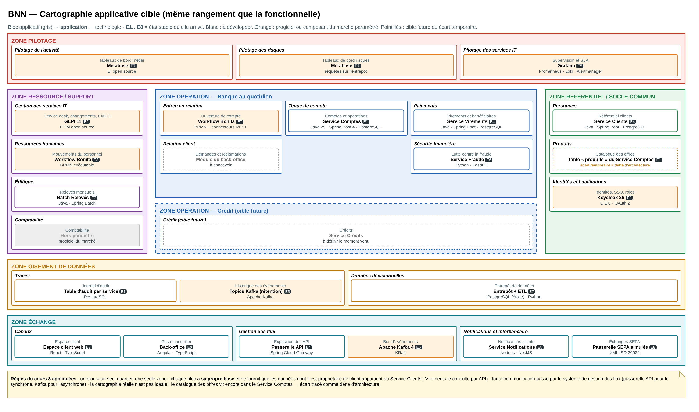

# MiniBank — le système d'information d'une banque en ligne, construit comme dans une DSI

> **Banque du Nord Numérique (BNN)** : une banque de détail fictive, 100 % en ligne, basée à Lille.
> MiniBank est son système d'information complet, de la stratégie jusqu'au code, aux tests et à l'exploitation.
> Projet personnel d'apprentissage et portfolio — banque, clients et montants fictifs, aucun argent réel.


---

## Pourquoi ce projet

Dans une banque, un logiciel n'existe jamais seul : il vit dans un **système d'information** fait de
processus métier, d'applications qui échangent des flux, de règles de sécurité, d'engagements de service
et d'équipes qui l'exploitent. Les projets d'école montrent rarement cette réalité.

MiniBank a été pensé pour la montrer, et pour la pratiquer :

- **Construire un SI entier, pas une application isolée** : une dizaine d'applications (services Java,
  fronts React et Angular, service de fraude Python, notifications Node.js, workflow Bonita, ITSM GLPI,
  entrepôt de données) reliées par des flux documentés.
- **Travailler avec toutes les casquettes d'une DSI** : MOA, urbaniste, architecte, développeur, testeur,
  DevOps/SRE, RSSI, DPO, gestionnaire des services IT. Chaque livrable du dossier `docs/` correspond à
  l'une d'elles.
- **Appliquer les exigences d'un domaine critique** : exactitude des montants au centime, opérations
  immuables, virements atomiques et idempotents, contrôle de fraude, traçabilité, RGPD.
- **Avancer par états stables** : chaque étape livre un SI qui fonctionne et que l'on peut démontrer,
  comme une trajectoire d'urbanisation réelle.

Il relie aussi mes cours de M2 (urbanisation du SI, ITSM/ITIL, BPMN, conception objet) à une mise en
pratique de bout en bout.

## La banque et ses objectifs

| N° | Orientation stratégique | Objectif mesurable | Réponse du SI |
|---|---|---|---|
| O1 | Banque 100 % en ligne | Ouvrir un compte en < 10 min, décision < 24 h ouvrées | Workflow Bonita d'ouverture, contrôles automatiques |
| O2 | Confiance et sécurité | < 0,1 % de virements frauduleux exécutés, aucune fuite | Service Fraude, Keycloak (OIDC), journal d'audit |
| O3 | Pilotage par la donnée | Indicateurs de la veille disponibles à 8 h | ETL nocturne, entrepôt en étoile, Metabase |
| O4 | Qualité de service | Disponibilité 99,5 %/mois, incident majeur < 4 h | Supervision Prometheus/Grafana, GLPI, PRA |

Trois personas guident les besoins : **Claire Martin** (cliente), **Karim Benali** (conseiller),
**Julie Moreau** (administratrice sécurité).

## L'architecture cible



| Zone › quartier | Application | Technologie |
|---|---|---|
| Échange › Canaux | Espace client · Back-office conseiller | React + TypeScript · Angular |
| Échange › Gestion des flux | Passerelle API · Bus d'événements | Spring Cloud Gateway · Kafka 4 (KRaft) |
| Échange › Notifications | Service Notifications · Passerelle SEPA simulée | Node.js NestJS · XML ISO 20022 |
| Opération › Tenue de compte | **Service Comptes** | Java 25, Spring Boot 4.1, PostgreSQL 17 |
| Opération › Paiements | Service Virements | Java, Spring Boot |
| Opération › Sécurité financière | Service Fraude (score de risque) | Python, FastAPI |
| Opération › Entrée en relation | Workflow d'ouverture de compte | Bonita (BPMN) |
| Référentiel | Service Clients · Identités et accès | Java · Keycloak 26 (OIDC) |
| Support | Gestion des services IT · Relevés mensuels | GLPI 11 · Spring Batch |
| Pilotage | Tableaux de bord · Supervision | Metabase · Prometheus, Loki, Grafana, Alertmanager |

**Principes d'architecture** (détaillés dans les [ADR](docs/adr/)) :

- une base de données par service : aucun service ne lit la base d'un autre (ADR-012) ;
- appels synchrones via la passerelle, événements asynchrones via Kafka avec le patron *outbox* (ADR-005, ADR-011) ;
- pas d'ESB : un bloc ne fournit que ses propres données ;
- monolithe modulaire d'abord, découpage en microservices quand le besoin est prouvé (ADR-002) ;
- montants en `BigDecimal` / `NUMERIC(19,2)`, arrondi bancaire `HALF_EVEN` (ADR-003) ;
- verrouillage optimiste `@Version` contre les mises à jour perdues (ADR-004).

## Le fil rouge : un virement

Un virement traverse presque tout le SI, ce qui en fait le scénario de démonstration :

1. Claire s'authentifie (Keycloak, OIDC) et initie un virement depuis l'Espace client — **idempotent** pendant 24 h.
2. Au-delà de 1 000 €, le Service Fraude calcule un **score de risque** en moins de 300 ms ; refus à partir de 70.
3. Le débit et le crédit sont exécutés de façon **atomique** ; chaque opération est **immuable**.
4. L'événement « virement exécuté » part sur Kafka ; le Service Notifications prévient Claire.
5. La nuit, l'ETL alimente l'entrepôt ; à 8 h, les indicateurs sont prêts.

Les 17 flux entre applications (F01 à F17) sont décrits dans la
[cartographie applicative et des flux](docs/urbanisation/cartographie-applicative-et-flux.md).

## Trajectoire : 8 états stables

| État | Contenu | Période | Statut |
|---|---|---|---|
| **E1** | Cœur bancaire : Service Comptes, modèle objet riche, règles RG-01 à RG-10, tests, CI | nov.–déc. 2026 | 🟠 en cours |
| E2 | Banque en ligne : Espace client React, GLPI | déc. 2026 | ⚪ à venir |
| E3 | Accès : Keycloak, processus d'arrivée et de départ d'un conseiller (Bonita) | janv. 2027 | ⚪ à venir |
| E4 | SI urbanisé : Service Clients, Service Virements, passerelle, saga | janv.–févr. 2027 | ⚪ à venir |
| E5 | Événementiel : Kafka, Notifications NestJS, supervision | févr. 2027 | ⚪ à venir |
| E6 | Fraude en Python, back-office Angular | 2027 | ⚪ à venir |
| E7 | Ouverture de compte Bonita, entrepôt de données, relevés | 2027 | ⚪ à venir |
| E8 | Kubernetes (k3d), plan de reprise, SEPA, tests de charge | 2027 | ⚪ à venir |

## Démarrer

Prérequis : Java 25, Docker (Rancher Desktop ou Docker Desktop), Git.

```powershell
git clone https://github.com/Salah-eddine-boudi/minibank.git
cd minibank
Copy-Item .env.example infra\.env     # puis renseigne POSTGRES_PASSWORD dans infra\.env
cd infra
docker compose up -d                  # PostgreSQL 17 sur le port 5433
cd ..\comptes-service
.\mvnw.cmd test                       # tests (Linux/macOS : ./mvnw test)
.\mvnw.cmd spring-boot:run            # démarre le Service Comptes
curl.exe http://localhost:8080/actuator/health   # doit répondre {"status":"UP"}
```

## Structure du dépôt

```
minibank/
├── comptes-service/     Service Comptes (Spring Boot) — E1
├── infra/               infrastructure locale (docker compose), secrets dans infra/.env
├── docs/                sélection du dossier du SI (voir ci-dessous)
├── AGENTS.md, CLAUDE.md règles communes aux agents de code IA
└── .github/             intégration continue, modèles d'issues et de pull requests
```

## Documentation du SI

Le dossier [`docs/`](docs/) rassemble une sélection de la conception, un document par casquette :

| Casquette | Documents |
|---|---|
| MOA | [Cahier des charges](docs/cahier-des-charges.md) : exigences, règles de gestion RG-01 à RG-15, UML |
| Architecte | [Dossier d'architecture](docs/architecture/dossier-architecture.md), [14 ADR](docs/adr/), [modèle de données](docs/architecture/modele-de-donnees.md), [conception objet](docs/conception-objet.md) |
| API | [Conventions d'API](docs/architecture/conventions-api.md), [contrat OpenAPI](docs/api/openapi.yaml) |
| Urbaniste | [Cartographie fonctionnelle](docs/urbanisation/cartographie-fonctionnelle.md), [applicative et flux F01–F17](docs/urbanisation/cartographie-applicative-et-flux.md) |
| Testeur | [Stratégie de tests et recette](docs/tests/strategie-tests-et-recette.md) |
| RSSI, DPO | [Guide de sécurité](docs/securite/guide-securite.md), [risques et RGPD](docs/securite/risques-rgpd.md) |

Les schémas (UML/C4 avec leurs sources PlantUML, cartographies, BPMN) sont dans [`docs/schemas/`](docs/schemas/).

## Qualité et méthode

- **Traçabilité** : chaque règle de gestion (RG-xx) a son test, dont le nom porte le numéro de la règle.
- **Tests d'intégration** sur un vrai PostgreSQL (Testcontainers), jamais sur une base en mémoire.
- **Schéma versionné** par Flyway ; API versionnées `/api/v1`, erreurs au format Problem Details (RFC 9457).
- **Git** : une branche par user story, Conventional Commits, fusion par pull request après CI verte.
- **Agents de code IA** : j'utilise Claude Code et Codex comme binômes, encadrés par des règles écrites
  ([AGENTS.md](AGENTS.md)) ; chaque commit est relu et validé par moi.

## Auteur

**Salah Eddine Boudi** — étudiant en M2 à JUNIA (Lille), à la recherche d'un stage d'ingénieur logiciel
full stack de 6 mois à partir de mars 2027 (Java/Spring Boot, TypeScript/React, Node.js, Python, SQL, CI/CD).

[LinkedIn](https://www.linkedin.com/in/salah-eddine-boudi-b26b59252/) · [GitHub](https://github.com/Salah-eddine-boudi)

## Licence

Code sous licence [MIT](LICENSE). Banque, personnes et données entièrement fictives.
