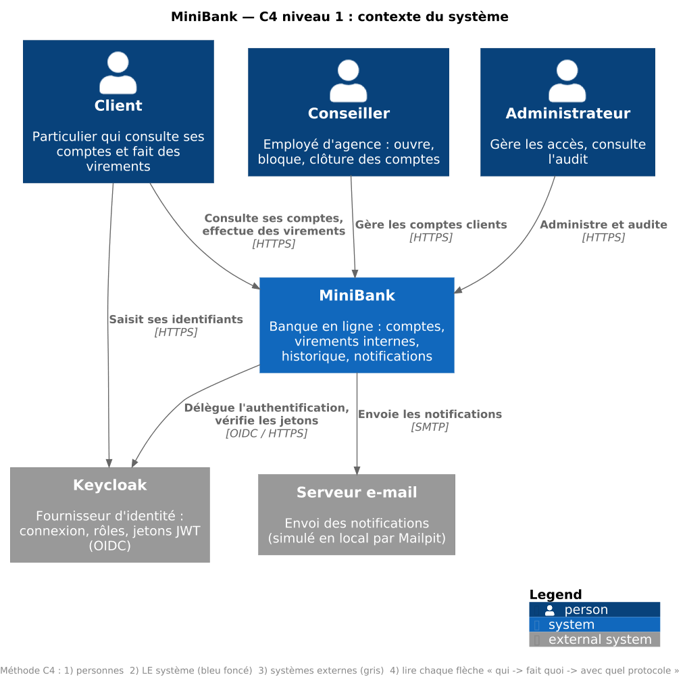
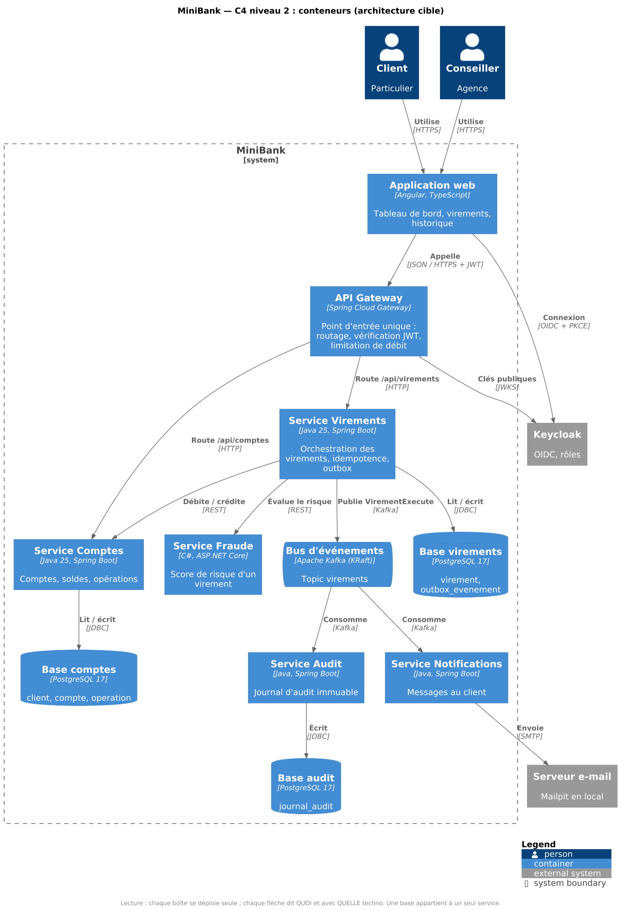

::: attention
**Mise à jour du 13 novembre 2026.** Ce document date du kit d'octobre. Les choix de langages ont évolué (ADR-008 à ADR-014) : Espace client en **React**, back-office en **Angular**, Service Fraude en **Python**, Notifications en **NestJS**, et les phases P0 à P8 sont remplacées par les **états stables E1 à E8** (`01_Pilotage_et_organisation/01_Feuille_de_route_E1-E8.pdf`).
:::


# Objet du document

Un **dossier d'architecture technique (DAT)** explique comment le système est construit et **pourquoi**. Il sert à trois publics : le développeur qui arrive sur le projet, l'architecte qui vérifie la cohérence, et l'exploitant qui déploie. Les décisions importantes sont détaillées dans des **ADR** (*Architecture Decision Records*), un fichier par décision, dans le dossier `adr/`.

# Principes d'architecture

| Principe | Ce que ça veut dire | Application dans MiniBank |
|---|---|---|
| Simplicité d'abord | On ne complexifie que si un besoin le justifie | Un seul service en phase 1, découpage en phase 4 (ADR-002) |
| Séparation des responsabilités | Chaque couche, chaque service a un rôle unique | Couches web / service / repository / domaine |
| Le domaine au centre | Les règles métier ne dépendent pas des frameworks | `Compte.debiter()` est testable sans Spring |
| Une base par service | Aucun service ne lit la base d'un autre | Base comptes, base virements, base audit |
| Sécurité dès la conception | La sécurité n'est pas ajoutée à la fin | Cloisonnement des données dès la phase 3, audit dès la phase 5 |
| Tout est automatisé | Ce qui est manuel finit par être oublié | Tests et analyse qualité à chaque *push* |
| Tolérance aux pannes | Un service en panne ne doit pas tout faire tomber | Délais d'attente, disjoncteur, compensation, outbox |

# Vue de contexte (C4 niveau 1)

{width=85%}

MiniBank est utilisé par trois profils (client, conseiller, administrateur). Il délègue l'authentification à **Keycloak** et l'envoi d'e-mails à un serveur SMTP (Mailpit en local, qui capture les e-mails sans les envoyer).

# Évolution de l'architecture par phases

L'architecture n'est pas construite d'un coup. Chaque phase ajoute une brique et un apprentissage.

| Phase | Architecture | Ce que tu apprends |
|---|---|---|
| P1 | **Monolithe modulaire** : un service Spring Boot + PostgreSQL | Couches, JPA, transactions, verrouillage |
| P2 (E2) | + Espace client React | Front séparé, CORS, appels HTTP |
| P3 | + Keycloak | OIDC, JWT, rôles, cloisonnement |
| P4 | **Découpage** : service Virements séparé + passerelle | Appels entre services, pannes partielles, compensation |
| P5 | + Kafka, Notifications, Audit | Asynchrone, outbox, consommateurs idempotents |
| P6 (E6) | + Service Fraude en Python FastAPI, back-office Angular | Interopérabilité, contrat d'API |
| P7 | + CI/CD, qualité, tests avec conteneurs | Industrialisation |
| P8 | + Batch, supervision, cloud | Exploitation |

## Architecture cible (C4 niveau 2)

{width=100%}

# Architecture interne d'un service

Chaque service Spring Boot suit la même organisation en couches (diagramme 08) :

```
com.minibank.comptes
├── web          ← contrôleurs REST, gestion des erreurs HTTP
├── dto          ← objets d'entrée/sortie de l'API (records)
├── service      ← logique applicative, transactions
├── domain       ← entités et règles métier
├── repository   ← accès aux données (Spring Data JPA)
├── exception    ← exceptions métier
└── config       ← configuration (sécurité, OpenAPI…)
```

**Pourquoi des DTO ?** L'entité `Compte` est le modèle interne ; elle ne doit jamais être exposée telle quelle. Les DTO protègent contre l'**affectation massive** (un client qui enverrait `"solde": 1000000` dans le JSON), évitent les boucles de sérialisation et permettent de faire évoluer la base sans casser l'API.

# Communication entre services

| Type | Technologie | Quand l'utiliser | Exemple |
|---|---|---|---|
| **Synchrone** | REST (HTTP + JSON), client OpenFeign ou RestClient | On a besoin de la réponse tout de suite pour continuer | Virements demande à Comptes de débiter |
| **Asynchrone** | Kafka (événements) | Les autres doivent être informés, sans bloquer l'émetteur | « Virement exécuté » → Notifications, Audit |

**Règle pratique.** Synchrone pour **commander** et obtenir un résultat (« débite ce compte »). Asynchrone pour **informer** que quelque chose s'est passé (« un virement a été exécuté »). Un événement est écrit au passé.

## Le problème de la transaction distribuée

Dans un seul service, `@Transactional` garantit « tout ou rien ». Entre deux services, **il n'existe pas de transaction commune** : le débit est dans une base, le crédit dans une autre (en phase 4, les deux appels passent par le service Comptes, mais ce sont deux requêtes HTTP distinctes). Solutions :

- **Saga avec compensation** : chaque étape a une action inverse. Si le crédit échoue après le débit, on recrédite la source (diagramme 11).
- **Pattern outbox** : pour publier un événement de façon fiable, on l'écrit dans une table `outbox_evenement` **dans la même transaction** que la modification métier ; un relais le publie ensuite dans Kafka. Sans outbox, une panne entre le *commit* et l'envoi Kafka ferait perdre l'événement.
- **Consommateurs idempotents** : Kafka garantit au moins une livraison (*at-least-once*), donc un message peut arriver deux fois. Le consommateur mémorise les identifiants d'événements déjà traités.

# Données

| Sujet | Décision | Raison |
|---|---|---|
| SGBD | PostgreSQL 17 | Transactions ACID, types exacts, très répandu |
| Montants | `NUMERIC(19,2)` en base, `BigDecimal` en Java | Aucune erreur d'arrondi (ADR-003) |
| Concurrence | Verrouillage optimiste (`@Version`) | Peu de conflits attendus, pas de verrou long (ADR-004) |
| Schéma | `ddl-auto: update` en P1, puis migrations Flyway versionnées (P7) | Apprendre vite, puis faire comme en production |
| Historique | Table `operation` en ajout seul | Traçabilité comptable (RG-08) |
| Dates | `TIMESTAMPTZ` en base, `Instant` en Java (UTC) | Pas d'ambiguïté de fuseau horaire |

# Résilience

| Mécanisme | Problème résolu | Outil |
|---|---|---|
| Délai d'attente (*timeout*) | Un service lent bloque tous les appelants | Configuration du client HTTP (2 s vers Fraude) |
| Nouvelles tentatives (*retry*) | Erreurs passagères (réseau) | Resilience4j, seulement pour des appels idempotents |
| Disjoncteur (*circuit breaker*) | Un service en panne est appelé en boucle | Resilience4j : après N échecs, on arrête d'appeler un moment |
| Repli (*fallback*) | Que faire si l'appel échoue ? | Fraude indisponible → refus prudent (CONTROLE_INDISPONIBLE) |
| Sondes de santé | Redémarrer ou isoler un service malade | Actuator : *liveness* et *readiness* |

> **Attention aux nouvelles tentatives.** Retenter un débit qui a peut-être réussi peut débiter deux fois. On ne retente que des opérations **idempotentes**, d'où la clé d'idempotence sur les virements.

# Sécurité (vue d'architecture)

- **Authentification déléguée** à Keycloak (OIDC, code d'autorisation + PKCE) : MiniBank ne voit jamais les mots de passe.
- **Passerelle** : vérifie la signature et l'expiration du JWT, applique une limitation de débit.
- **Chaque service** revérifie le jeton et applique les règles d'accès métier (un client n'accède qu'à ses comptes) : on ne fait pas confiance au réseau interne (*zero trust*).
- **Secrets** hors du code : variables d'environnement, jamais dans Git.
- Détails : `08_Securite/Guide_securite.md`.

# Observabilité

| Pilier | Question | Outil |
|---|---|---|
| Journaux (*logs*) | Que s'est-il passé ? | SLF4J/Logback, format JSON, identifiant de corrélation |
| Métriques | Combien, à quelle vitesse ? | Micrometer + Prometheus, tableaux Grafana |
| Traces | Par où est passée cette requête ? | OpenTelemetry (traceId propagé entre services) |
| Santé | Le service est-il vivant et prêt ? | Actuator `/health` |

# Environnements

| Environnement | Usage | Données | Déploiement |
|---|---|---|---|
| Développement (ton PC) | Coder, tester | Jeu de test local | `docker compose up` + `mvnw spring-boot:run` |
| Intégration continue | Vérifier chaque *push* | Bases éphémères (Testcontainers) | GitHub Actions |
| Recette (phase 8, cloud) | Démonstration, tests de bout en bout | Données fictives | Images Docker publiées |

Dans une banque réelle, il y a souvent plus d'environnements : développement, intégration, recette, **pré-production** (copie de la production pour les derniers tests), production. Chacun a sa propre configuration, d'où les **profils Spring** (`application-dev.yml`, `application-recette.yml`…).

# Registre des décisions d'architecture (ADR)

| N° | Décision | Statut |
|---|---|---|
| [ADR-001](../adr/ADR-001-java-spring-boot.md) | Java 25 et Spring Boot 4 pour les services | Acceptée |
| [ADR-002](../adr/ADR-002-monolithe-modulaire-d-abord.md) | Monolithe modulaire d'abord, microservices ensuite | Acceptée |
| [ADR-003](../adr/ADR-003-montants-bigdecimal-numeric.md) | Montants en BigDecimal et NUMERIC(19,2) | Acceptée |
| [ADR-004](../adr/ADR-004-verrouillage-optimiste.md) | Verrouillage optimiste pour la concurrence | Acceptée |
| [ADR-005](../adr/ADR-005-kafka-et-outbox.md) | Kafka et pattern outbox pour les événements | Acceptée |
| [ADR-006](../adr/ADR-006-keycloak-oidc.md) | Authentification déléguée à Keycloak (OIDC) | Acceptée |
| [ADR-007](../adr/ADR-007-service-fraude-dotnet.md) | Service Fraude en ASP.NET Core | Remplacée par ADR-008 |
| [ADR-008](../adr/ADR-008-service-fraude-python.md) | Service Fraude en Python FastAPI | Acceptée |
| [ADR-009](../adr/ADR-009-fronts-react-et-angular.md) | Espace client React, back-office Angular | Acceptée |
| [ADR-010](../adr/ADR-010-notifications-nodejs-nestjs.md) | Notifications en Node.js NestJS | Acceptée |
| [ADR-011](../adr/ADR-011-kafka-systeme-de-gestion-des-flux.md) | Kafka comme système de gestion des flux, pas d'ESB | Acceptée |
| [ADR-012](../adr/ADR-012-une-base-par-service.md) | Une base de données par service | Acceptée |
| [ADR-013](../adr/ADR-013-glpi-outil-itsm.md) | GLPI pour la gestion des services IT | Acceptée |
| [ADR-014](../adr/ADR-014-bonita-processus-a-taches-humaines.md) | Bonita pour les processus à tâches humaines | Acceptée |
