::: attention
**Mise à jour du 13 novembre 2026.** Ce document date du kit d'octobre. Les choix de langages ont évolué (ADR-008 à ADR-014) : Espace client en **React**, back-office en **Angular**, Service Fraude en **Python**, Notifications en **NestJS**, et les phases P0 à P8 sont remplacées par les **états stables E1 à E8** (`01_Pilotage_et_organisation/01_Feuille_de_route_E1-E8.pdf`).
:::

# Fiche d'identification du document

| Rubrique | Valeur |
|---|---|
| Projet | MiniBank |
| Document | Cahier des charges fonctionnel et technique |
| Référence | MB-CDC-001 |
| Version | 1.0 |
| Statut | Validé pour démarrer la phase 1 |
| Maîtrise d'ouvrage (MOA) | Banque du Nord Numérique (BNN) — **client fictif** |
| Maîtrise d'œuvre (MOE) | Salah Eddine Boudi |
| Diffusion | Équipe projet, tuteur, recruteurs (portfolio) |

**Historique des versions**

| Version | Date | Auteur | Modification |
|---|---|---|---|
| 0.1 | 09/10/2026 | S. E. Boudi | Première ébauche : périmètre et feuille de route |
| 0.9 | 10/10/2026 | S. E. Boudi | Exigences, règles de gestion, modèle de données |
| 1.0 | 11/10/2026 | S. E. Boudi | Version validée : ajout sécurité, recette, planning |

> **Avertissement.** MiniBank est un **projet d'apprentissage**. La banque, ses clients et les montants sont fictifs. Aucun argent réel ne circule. Le document suit pourtant la structure et le niveau d'exigence d'un vrai cahier des charges d'ESN, pour s'entraîner dans des conditions réelles.

**Comment lire ce document.** Chaque exigence porte un identifiant unique (EF-xx pour une exigence fonctionnelle, ENF-xx pour une exigence non fonctionnelle, RG-xx pour une règle de gestion). Ces identifiants se retrouvent dans le backlog, les tests et les commits : c'est la **traçabilité**, exigée dans les projets bancaires. Les priorités suivent la méthode **MoSCoW** : *Must* (indispensable), *Should* (important), *Could* (souhaitable), *Won't* (pas dans cette version).

# Présentation du projet

## Contexte

La Banque du Nord Numérique (BNN) est une banque de détail régionale fictive, basée à Lille. Ses clients ne peuvent aujourd'hui consulter leurs comptes et faire un virement qu'en agence ou par téléphone. La concurrence des banques en ligne fait partir les clients les plus jeunes, et les conseillers passent une grande partie de leur temps sur des opérations simples.

La direction lance le projet **MiniBank** : une banque en ligne qui permet aux clients de gérer leurs comptes eux-mêmes, et aux conseillers de se concentrer sur le conseil.

## Enjeux

| Enjeu | Description |
|---|---|
| Métier | Rendre les clients autonomes sur les opérations courantes (consultation, virements internes). |
| Confiance | Une erreur sur un solde est inacceptable : exactitude des montants, traçabilité complète, aucune opération perdue ni doublée. |
| Sécurité | Protéger l'accès aux comptes : authentification forte, chaque client ne voit que ses données. |
| Évolutivité | Pouvoir ajouter de nouveaux services (fraude, notifications) sans tout réécrire. |
| Conformité | Respecter le RGPD (données personnelles) et les exigences d'audit d'une banque. |

## Objectifs (SMART)

Un objectif SMART est **S**pécifique, **M**esurable, **A**tteignable, **R**éaliste et **T**emporellement défini.

| N° | Objectif | Indicateur de réussite | Échéance |
|---|---|---|---|
| O1 | Un client consulte ses comptes et son historique en ligne | Parcours testé de bout en bout, temps de réponse p95 < 300 ms | Fin phase 2 |
| O2 | Un client fait un virement interne sûr | 0 double débit, 0 solde faux sur 100 virements concurrents (test automatisé) | Fin phase 1 |
| O3 | Les accès sont sécurisés | 100 % des routes protégées par jeton, tests 401/403 au vert | Fin phase 3 |
| O4 | Chaque opération est tracée | 100 % des écritures présentes dans le journal d'audit | Fin phase 5 |
| O5 | La qualité est mesurée automatiquement | Pipeline CI au vert, couverture des services ≥ 80 %, quality gate SonarCloud validé | Fin phase 7 |

## Périmètre

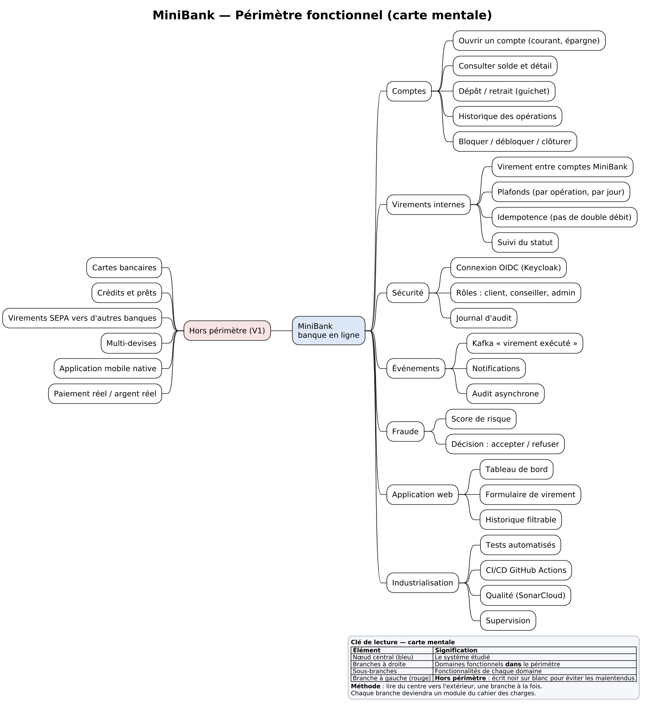{width=100%}

**Dans le périmètre (V1)** : gestion des comptes (ouverture, consultation, dépôt et retrait au guichet, blocage, clôture), historique des opérations, virements **internes** entre comptes MiniBank, plafonds, contrôle anti-fraude, authentification et rôles, notifications, journal d'audit, application web, chaîne d'industrialisation (tests, CI/CD, qualité).

**Hors périmètre (V1)** : cartes bancaires, crédits, virements SEPA vers d'autres banques, multi-devises (tout est en euros), application mobile native, découvert autorisé, argent réel. Écrire explicitement le hors-périmètre évite les malentendus avec le client : ce qui n'est pas écrit sera réclamé un jour.

## Parties prenantes

| Partie prenante | Rôle dans le projet | Attentes principales |
|---|---|---|
| Direction BNN (sponsor) | Finance et arbitre | Livraison dans les délais, image moderne |
| Product Owner BNN | Porte la vision, priorise le backlog, valide la recette | Fonctionnalités utiles, conformes aux règles métier |
| Clients particuliers | Utilisateurs finaux | Simplicité, rapidité, sécurité |
| Conseillers d'agence | Utilisateurs internes | Moins de tâches répétitives, vue sur les comptes |
| Responsable conformité (RSSI, DPO) | Contrôle | Audit, RGPD, sécurité |
| Équipe MOE (développeur) | Conçoit, développe, teste, livre | Exigences claires et stables, critères d'acceptation précis |

# Glossaire

Un glossaire commun évite que le client et l'équipe utilisent le même mot pour deux choses différentes.

| Terme | Définition |
|---|---|
| Compte | Compte bancaire identifié par un numéro unique (MB + 10 chiffres). Type courant ou épargne. |
| Solde | Montant disponible sur un compte, en euros, à 2 décimales. |
| Opération | Mouvement enregistré sur un compte (dépôt, retrait, virement émis ou reçu, intérêts). Jamais modifiée ni supprimée. |
| Virement interne | Transfert d'argent entre deux comptes MiniBank : un débit et un crédit indissociables. |
| Plafond | Montant maximum autorisé, par virement ou par jour. |
| Idempotence | Propriété d'une opération qui produit le même résultat si on la rejoue : un double clic ne débite qu'une fois. |
| Clé d'idempotence | Identifiant unique envoyé par le client avec une demande de virement pour détecter les doublons. |
| Score de risque | Note de 0 à 100 calculée par le service Fraude ; plus elle est haute, plus le virement est suspect. |
| Journal d'audit | Registre immuable de « qui a fait quoi, quand, sur quelle ressource, avec quel résultat ». |
| OIDC (OpenID Connect) | Protocole standard d'authentification, basé sur OAuth 2.0. |
| JWT (JSON Web Token) | Jeton signé qui transporte l'identité et les rôles de l'utilisateur. |
| MOA / MOE | Maîtrise d'ouvrage (le client qui exprime le besoin) / maîtrise d'œuvre (l'équipe qui réalise). |
| Recette | Phase où le client vérifie que le logiciel livré répond au cahier des charges. |
| MVP | *Minimum Viable Product* : la plus petite version utile et démontrable. |

# Expression des besoins

## Acteurs

| Acteur | Type | Description | Rôle technique |
|---|---|---|---|
| Client | Humain | Particulier titulaire d'un ou plusieurs comptes | `CLIENT` |
| Conseiller | Humain | Employé d'agence qui gère les comptes de ses clients | `CONSEILLER` |
| Administrateur | Humain | Gère les utilisateurs et consulte l'audit ; **n'accède pas** aux opérations financières (séparation des tâches) | `ADMIN` |
| Service Fraude | Système | Calcule un score de risque pour les virements importants | — |
| Planificateur | Système | Déclenche les traitements périodiques (intérêts mensuels) | — |

## Cas d'utilisation

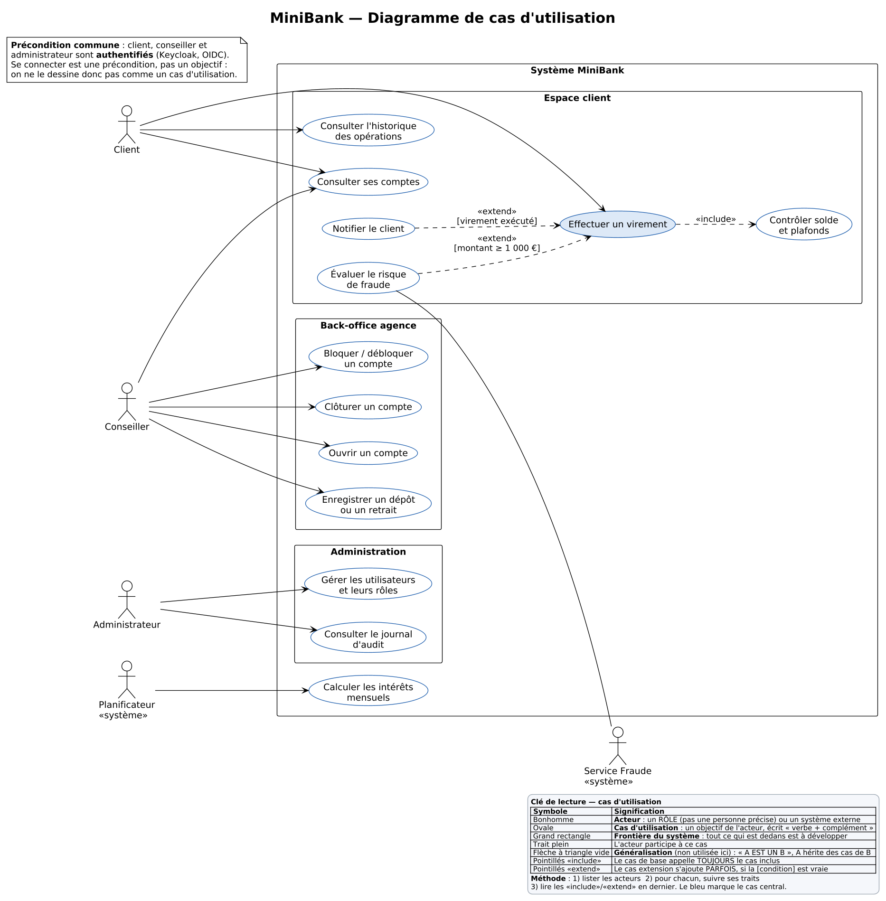{width=100%}

### Fiche détaillée : UC-03 « Effectuer un virement »

Une fiche de cas d'utilisation détaille chaque cas important. C'est le format attendu dans une spécification fonctionnelle détaillée (SFD).

| Rubrique | Contenu |
|---|---|
| Acteur principal | Client |
| Acteurs secondaires | Service Fraude, service Notifications |
| Objectif | Transférer de l'argent d'un de ses comptes vers un autre compte MiniBank |
| Préconditions | Le client est authentifié ; il possède au moins un compte ACTIF avec un solde positif |
| Postconditions (succès) | Le compte source est débité, le compte cible crédité du même montant ; deux opérations sont enregistrées ; le client est notifié ; l'action est auditée |
| Postconditions (échec) | Aucun solde n'a changé ; le motif du refus est communiqué et enregistré |
| Déclencheur | Le client valide le formulaire de virement |

**Scénario nominal**

1. Le client ouvre le formulaire de virement ; le système affiche ses comptes débitables et leurs soldes.
2. Le client saisit le compte cible, le montant et un motif, puis valide.
3. Le système vérifie les données (RG-02, RG-04) et les plafonds (RG-05).
4. Si le montant atteint 1 000 €, le système demande un score au service Fraude (RG-11).
5. Le système débite le compte source et crédite le compte cible dans une même transaction (RG-09).
6. Le système confirme au client avec la référence du virement et le nouveau solde.
7. Le système publie l'événement « virement exécuté » : le client reçoit une notification, l'audit l'enregistre.

**Scénarios alternatifs et d'erreur**

| Réf. | Au pas | Situation | Comportement attendu |
|---|---|---|---|
| A1 | 2 | Le client clique deux fois sur « Valider » | Un seul virement : la seconde demande renvoie le résultat de la première (RG-10) |
| E1 | 3 | Montant nul, négatif ou à plus de 2 décimales | Refus, message sous le champ, rien n'est débité |
| E2 | 3 | Compte cible inexistant ou identique au compte source | Refus avec message explicite |
| E3 | 3 | Plafond dépassé | Refus `PLAFOND_DEPASSE` avec le montant encore disponible aujourd'hui |
| E4 | 4 | Score de risque ≥ 70 | Refus `RISQUE_FRAUDE`, le conseiller est alerté |
| E5 | 4 | Service Fraude indisponible | Refus prudent `CONTROLE_INDISPONIBLE` (le virement n'est pas exécuté sans contrôle) |
| E6 | 5 | Solde insuffisant | Refus `SOLDE_INSUFFISANT` |
| E7 | 5 | Compte source bloqué ou clôturé | Refus `COMPTE_INDISPONIBLE` |
| E8 | 5 | Le compte a été modifié en même temps par une autre opération | Refus temporaire, le client peut réessayer (409) |

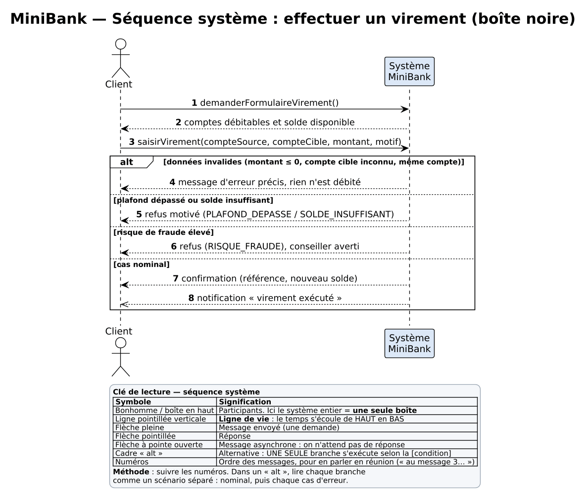{width=95%}

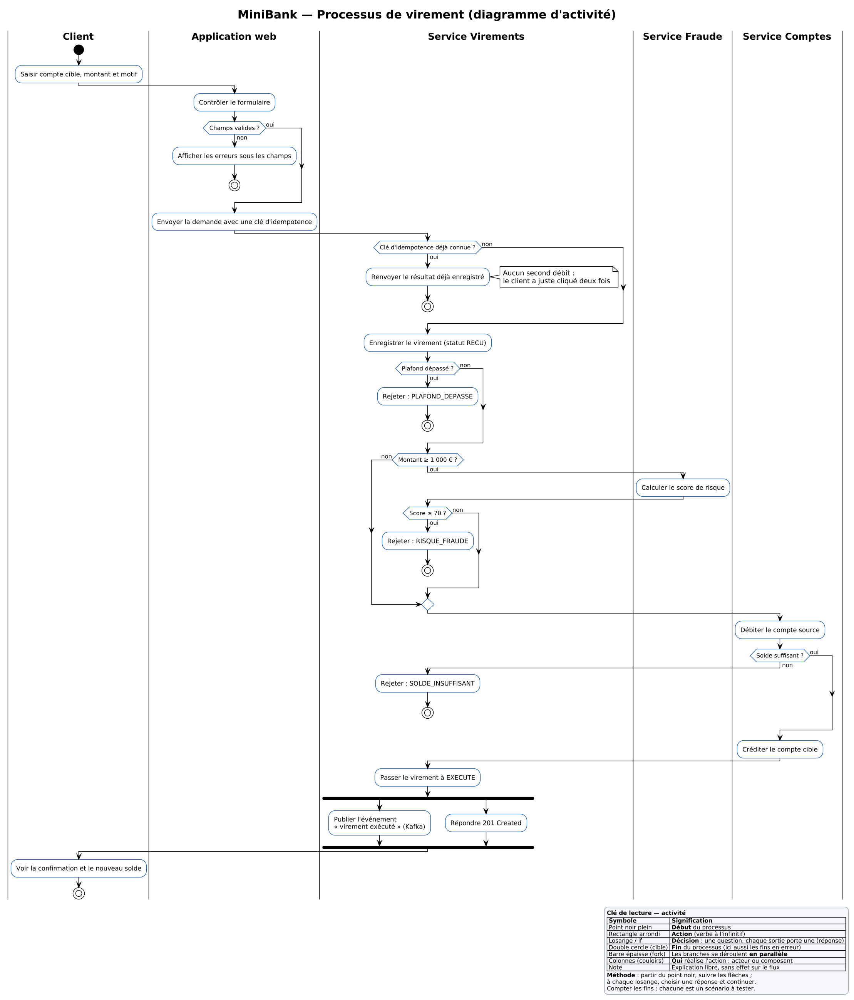{width=100%}

## Exigences fonctionnelles

Chaque exigence est rattachée à une phase de la feuille de route (P1 à P8).

### Module Comptes

| ID | Exigence | Priorité | Phase |
|---|---|---|---|
| EF-01 | Le conseiller ouvre un compte (courant ou épargne) pour un client ; le système génère un numéro unique et initialise le solde à 0,00 €. | Must | P1 |
| EF-02 | Un utilisateur autorisé consulte un compte : numéro, type, titulaire, solde, statut, date d'ouverture. | Must | P1 |
| EF-03 | Le client liste tous ses comptes avec leurs soldes. | Must | P3 |
| EF-04 | Le conseiller enregistre un dépôt d'espèces au guichet. | Must | P1 |
| EF-05 | Le conseiller enregistre un retrait au guichet, refusé si le solde est insuffisant. | Must | P1 |
| EF-06 | L'utilisateur consulte l'historique d'un compte, du plus récent au plus ancien, paginé par 20, filtrable par période (12 mois maximum). | Must | P1 |
| EF-07 | Le conseiller bloque ou débloque un compte, avec un motif obligatoire. | Should | P1 |
| EF-08 | Le conseiller clôture un compte dont le solde est nul. | Should | P1 |

### Module Virements

| ID | Exigence | Priorité | Phase |
|---|---|---|---|
| EF-10 | Le client effectue un virement interne depuis un de ses comptes vers n'importe quel compte MiniBank. | Must | P1 |
| EF-11 | Le système garantit l'idempotence : une même clé d'idempotence ne produit qu'un seul virement. | Must | P1 (bonus) |
| EF-12 | Le système applique les plafonds par virement et par jour. | Must | P4 |
| EF-13 | Le client consulte le statut et le détail d'un virement par sa référence. | Should | P4 |
| EF-14 | Un virement suit le cycle de vie défini en annexe (RECU, EN_CONTROLE, VALIDE, EXECUTE, REJETE, ECHOUE). | Must | P4 |

### Module Sécurité

| ID | Exigence | Priorité | Phase |
|---|---|---|---|
| EF-20 | L'utilisateur se connecte via le fournisseur d'identité (Keycloak, OIDC). | Must | P3 |
| EF-21 | L'utilisateur se déconnecte ; sa session est invalidée. | Must | P3 |
| EF-22 | Chaque action est autorisée selon le rôle (voir « Matrice des droits »). | Must | P3 |
| EF-23 | Un client n'accède qu'à ses propres comptes et virements. | Must | P3 |
| EF-24 | L'administrateur crée, désactive et attribue les rôles des comptes utilisateurs. | Should | P3 |

### Module Fraude

| ID | Exigence | Priorité | Phase |
|---|---|---|---|
| EF-50 | Le service Fraude calcule un score de 0 à 100 pour un virement et renvoie la décision et ses raisons. | Should | P6 |
| EF-51 | Un virement d'au moins 1 000 € n'est exécuté qu'après une décision ACCEPTER. | Should | P6 |

### Modules Notifications et Audit

| ID | Exigence | Priorité | Phase |
|---|---|---|---|
| EF-30 | Le client reçoit une notification après chaque virement exécuté (e-mail simulé). | Should | P5 |
| EF-40 | Chaque écriture (ouverture, dépôt, retrait, virement, blocage, clôture, changement de rôle) est inscrite au journal d'audit. | Must | P5 |
| EF-41 | L'administrateur consulte le journal d'audit, filtré par date, acteur et action. | Should | P5 |

### Application web

| ID | Exigence | Priorité | Phase |
|---|---|---|---|
| EF-60 | Tableau de bord : liste des comptes, soldes, 5 dernières opérations. | Must | P2 |
| EF-61 | Formulaire de virement avec validation en direct et confirmation avant envoi. | Must | P2 |
| EF-62 | Page d'historique avec pagination et filtre par dates. | Must | P2 |
| EF-63 | Messages d'erreur compréhensibles par un client (jamais de trace technique). | Must | P2 |

### Traitements périodiques

| ID | Exigence | Priorité | Phase |
|---|---|---|---|
| EF-70 | Le 1er de chaque mois, le système calcule et verse les intérêts des comptes épargne (RG-14). | Could | P8 |
| EF-71 | Le système produit un relevé mensuel par compte (CSV ou PDF). | Could | P8 |

## Règles de gestion

Les règles de gestion décrivent les lois du métier, indépendamment de toute technique. Elles deviennent du code (méthodes de l'entité, contrôles du service) et des tests.

| ID | Règle | Exemple concret |
|---|---|---|
| RG-01 | Un numéro de compte est unique et suit le format `MB` + 10 chiffres. | `MB0001234567` |
| RG-02 | Tout montant est strictement positif, en euros, avec au plus 2 décimales. | 0,00 € refusé ; 12,345 € refusé ; 12,34 € accepté |
| RG-03 | Le solde d'un compte ne peut jamais devenir négatif (pas de découvert en V1). | Solde 100 €, retrait de 100,01 € refusé |
| RG-04 | Un virement vers le compte source lui-même est interdit. | `MB…567` vers `MB…567` refusé |
| RG-05 | Plafonds : 5 000 € par virement ; 10 000 € par jour et par compte source (somme des virements exécutés le jour calendaire, heure de Paris). | Déjà 8 000 € virés aujourd'hui : un virement de 2 500 € est refusé, 2 000 € accepté |
| RG-06 | Un compte BLOQUE peut être crédité mais pas débité. Un compte CLOTURE n'accepte plus aucune opération. | Salaire reçu sur un compte bloqué : accepté |
| RG-07 | Un compte ne peut être clôturé que si son solde est exactement 0,00 €. | Solde 0,01 € : clôture refusée |
| RG-08 | Une opération enregistrée n'est jamais modifiée ni supprimée ; une correction se fait par une opération inverse. | Erreur de dépôt de 50 € : retrait correctif de 50 € avec libellé « correction » |
| RG-09 | Un virement est atomique : débit et crédit réussissent ensemble ou échouent ensemble. | Panne entre les deux : aucun des deux soldes ne bouge (ou compensation en P4) |
| RG-10 | Une clé d'idempotence est conservée 24 h ; une demande identique avec la même clé renvoie le premier résultat ; une demande différente avec la même clé est refusée (409). | Double clic : un seul débit |
| RG-11 | Tout virement d'au moins 1 000 € est soumis au service Fraude ; un score ≥ 70 entraîne un refus. | 1 500 € vers un nouveau bénéficiaire à 3 h : 30 + 20 = 50, accepté ; 3 500 € dans les mêmes conditions : 40 + 30 + 20 = 90, refusé |
| RG-12 | Calcul du score (version 1, explicable) : +40 si montant > 3 000 € ; +30 si le compte cible n'a jamais reçu de virement de ce client ; +20 si plus de 3 virements dans l'heure ; +20 si heure entre 0 h et 5 h. Score plafonné à 100. | 3 500 € vers un nouveau bénéficiaire : 40 + 30 = 70, refusé |
| RG-13 | Les montants sont stockés en décimal exact (jamais en nombre à virgule flottante) et arrondis au centime selon l'arrondi bancaire (HALF_EVEN) quand un calcul en produit plus. | Intérêts de 1,005 € : arrondis à 1,00 € |
| RG-14 | Intérêts épargne (simplification pédagogique) : solde de fin de mois × taux annuel ÷ 12, taux paramétrable (2,00 % par défaut). | 6 000 € × 2 % ÷ 12 = 10,00 € |
| RG-15 | Un client détient au plus 1 compte courant et 2 comptes épargne actifs. | 3e compte épargne refusé |

# Exigences non fonctionnelles

Les exigences non fonctionnelles décrivent **comment** le système doit se comporter : vitesse, sécurité, fiabilité. Ce sont souvent elles qui font échouer un projet, car on les découvre trop tard.

| ID | Catégorie | Exigence | Mesure de vérification |
|---|---|---|---|
| ENF-01 | Performance | Lectures : temps de réponse p95 < 300 ms ; virement complet p95 < 800 ms, pour 20 utilisateurs simultanés sur l'environnement local | Test de charge (k6 ou Gatling), phase 8 |
| ENF-02 | Intégrité | Aucune perte ni double comptabilisation, y compris en cas d'accès concurrents | Test de 100 virements parallèles, somme des soldes constante |
| ENF-03 | Disponibilité | Chaque service expose `/actuator/health` (liveness et readiness) et redémarre automatiquement en cas d'arrêt | Arrêt forcé d'un conteneur en recette |
| ENF-04 | Sécurité | Authentification OIDC ; jetons d'accès de 5 min ; HTTPS hors poste de développement ; mots de passe jamais stockés par MiniBank | Revue de sécurité, tests 401/403 |
| ENF-05 | Sécurité | Protection contre les 10 risques de l'OWASP Top 10 (2025) | Grille du guide sécurité, analyse SonarCloud et dépendances |
| ENF-06 | Traçabilité | Chaque requête porte un identifiant de corrélation (traceId) présent dans tous les journaux | Recherche d'un traceId de bout en bout |
| ENF-07 | Confidentialité | Aucune donnée sensible dans les journaux (jeton, mot de passe) ; numéros de compte masqués (`MB******4567`) | Revue des journaux en recette |
| ENF-08 | RGPD | Minimisation : seuls nom, prénom et e-mail sont collectés ; registre des traitements documenté | Revue DPO (fictive) |
| ENF-09 | Maintenabilité | Couverture de tests ≥ 80 % sur les couches service et domaine ; aucune anomalie bloquante SonarCloud | Rapport JaCoCo et quality gate |
| ENF-10 | Portabilité | Tout l'environnement démarre avec `docker compose up` ; configuration externalisée par profils | Démarrage sur un poste neuf |
| ENF-11 | Accessibilité | Application web conforme aux bases du RGAA : libellés de champs, contraste, navigation au clavier | Audit Lighthouse ≥ 90 en accessibilité |
| ENF-12 | Compatibilité | Dernières versions de Chrome, Firefox et Edge ; affichage correct sur mobile (≥ 360 px) | Tests manuels de recette |
| ENF-13 | Observabilité | Métriques techniques et métier (nombre de virements, taux de refus) exposées et visualisables | Tableau Grafana, phase 8 |

# Contraintes

## Contraintes techniques

| Domaine | Choix imposé | Justification |
|---|---|---|
| Langage back-end | Java 25 (LTS) | Version maintenue à long terme, standard des ESN et banques |
| Framework | Spring Boot 4.1 | Standard du marché pour les API d'entreprise |
| Base de données | PostgreSQL 17 | Transactionnelle (ACID), libre, très répandue |
| Front-end | React + TypeScript (espace client) ; Angular (back-office) — ADR-009 | Les deux frameworks les plus demandés ; Angular très utilisé chez les grands comptes |
| Messagerie | Apache Kafka (mode KRaft) | Événements asynchrones, découplage des services |
| Identité | Keycloak (OIDC) | Standard ouvert, évite de développer l'authentification soi-même |
| Autres langages | Python (FastAPI) pour le service Fraude, TypeScript (NestJS) pour les notifications — ADR-008, ADR-010 | Interopérabilité par contrats d'API ; aligné sur le CV |
| Conteneurs | Docker, Docker Compose (Rancher Desktop sur le poste) | Environnement identique pour tous |
| Outillage | Git, GitHub, GitHub Actions, VS Code, Maven Wrapper | Gratuits, standards |

Les justifications détaillées de chaque choix sont consignées dans les *Architecture Decision Records* (dossier `04_Architecture/adr`).

## Contraintes organisationnelles

- Un développeur, environ 8 à 10 heures par semaine en parallèle des cours.
- Travail en itérations d'une à deux semaines ; une démonstration à la fin de chaque phase.
- Tout le code est versionné sur GitHub ; chaque fonctionnalité passe par une *pull request* relue (auto-revue avec la grille du guide de développement).

## Contraintes réglementaires (simulées)

- **RGPD** : minimisation, finalité déclarée, droit d'accès et de rectification, durée de conservation.
- **Lutte anti-blanchiment et connaissance client (KYC)** : traçabilité des opérations, conservation des données pendant la durée légale.
- **DSP2** (directive sur les services de paiement) : authentification forte du client pour l'accès aux comptes en ligne ; dans MiniBank, elle est simulée par le second facteur de Keycloak (Should).

# Solution attendue

## Architecture cible

L'architecture évolue par phases : un service unique en phase 1, puis un découpage en microservices en phase 4. Ce choix est volontaire : on ne découpe que lorsqu'on comprend le domaine (voir ADR-002).

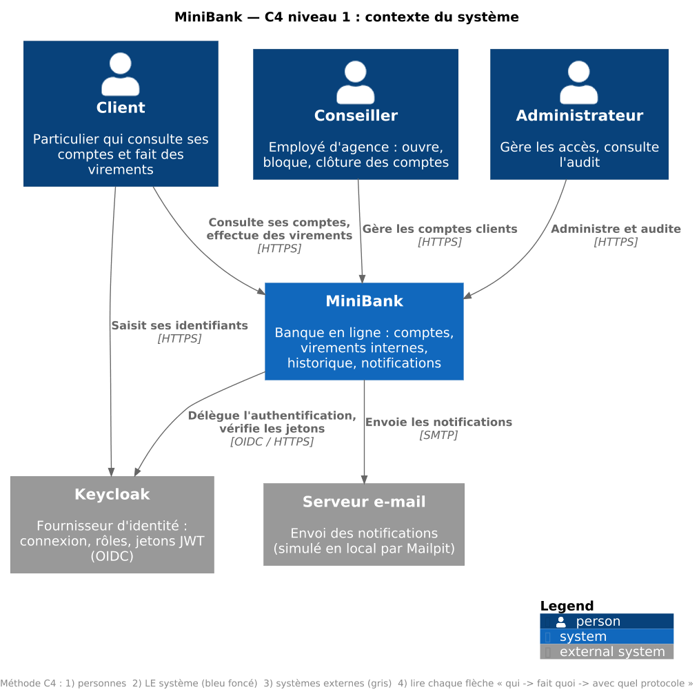{width=85%}

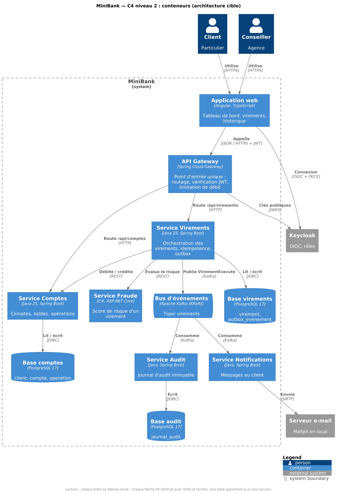{width=100%}

## Modèle de données

Une base par service : aucune clé étrangère ne traverse deux bases. En phase 1, la table `compte` porte le nom du titulaire en texte ; la table `client` arrive en phase 3, avec l'identité Keycloak.

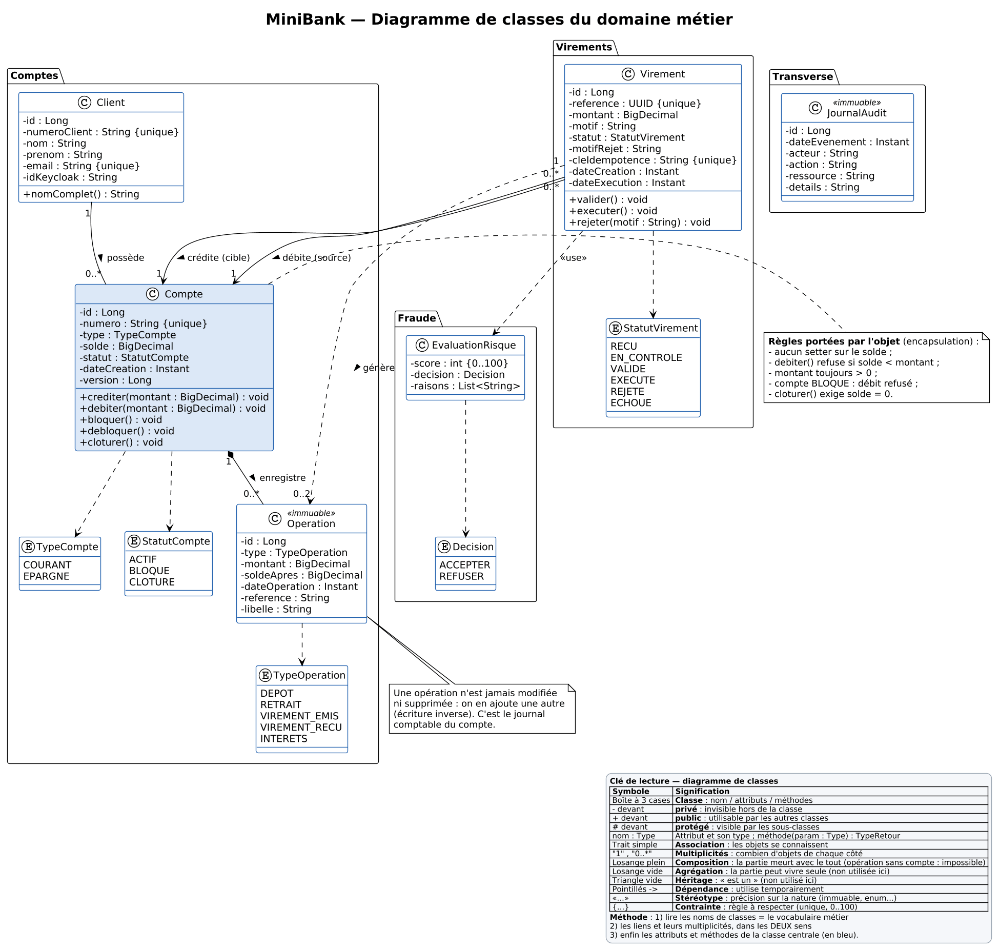{width=100%}

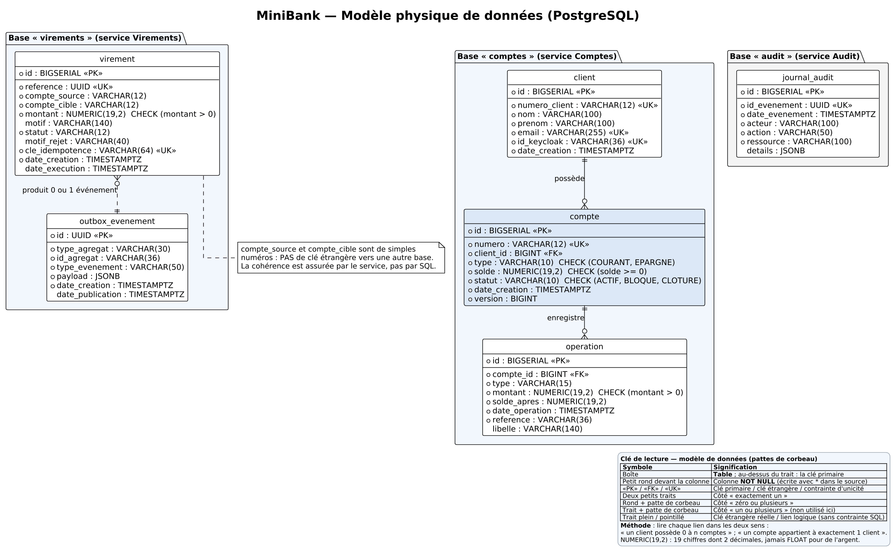{width=100%}

## Matrice des droits

| Action | CLIENT | CONSEILLER | ADMIN |
|---|---|---|---|
| Consulter ses propres comptes et historiques | Oui | — | Non |
| Consulter les comptes des clients | Non | Oui | Non |
| Effectuer un virement depuis ses comptes | Oui | Non | Non |
| Ouvrir, bloquer, débloquer, clôturer un compte | Non | Oui | Non |
| Enregistrer un dépôt ou un retrait | Non | Oui | Non |
| Gérer les utilisateurs et leurs rôles | Non | Non | Oui |
| Consulter le journal d'audit | Non | Non | Oui |

**Séparation des tâches** : l'administrateur technique gère les accès mais ne voit pas les opérations financières. Personne ne cumule les droits de créer un utilisateur et de faire des virements : c'est un principe classique de contrôle interne bancaire.

## Interfaces (API)

L'API suit les conventions REST décrites dans `06_API/Conventions_API.md`. Le contrat complet est au format OpenAPI dans `06_API/openapi.yaml`.

| Méthode | Ressource | Rôle | Succès | Erreurs |
|---|---|---|---|---|
| POST | `/api/comptes` | Ouvrir un compte | 201 + `Location` | 400, 403, 422 |
| GET | `/api/comptes/{numero}` | Consulter un compte | 200 | 403, 404 |
| POST | `/api/comptes/{numero}/depots` | Déposer | 200 | 400, 404, 422 |
| POST | `/api/comptes/{numero}/retraits` | Retirer | 200 | 400, 404, 422 |
| GET | `/api/comptes/{numero}/operations` | Historique paginé | 200 | 403, 404 |
| POST / DELETE | `/api/comptes/{numero}/blocage` | Bloquer / débloquer | 200 | 403, 404, 422 |
| POST | `/api/comptes/{numero}/cloture` | Clôturer | 200 | 403, 404, 422 |
| POST | `/api/virements` (en-tête `Idempotency-Key`) | Virer | 201 | 400, 404, 409, 422 |
| GET | `/api/virements/{reference}` | Statut d'un virement | 200 | 403, 404 |

Toutes les erreurs sont renvoyées au format standard *Problem Details* (RFC 9457) avec un code métier stable (`SOLDE_INSUFFISANT`, `PLAFOND_DEPASSE`…), exploitable par l'application web.

## Écrans de l'application web

| Écran | Contenu | Exigences |
|---|---|---|
| Connexion | Redirection vers la page Keycloak | EF-20 |
| Tableau de bord | Cartes des comptes (type, numéro masqué, solde), 5 dernières opérations, bouton « Faire un virement » | EF-60 |
| Virement | Choix du compte source, saisie du compte cible, montant, motif ; récapitulatif et confirmation ; écran de résultat avec référence | EF-61, EF-63 |
| Historique | Tableau paginé (date, libellé, montant coloré crédit/débit, solde après), filtre de dates | EF-62 |
| Back-office conseiller | Recherche d'un client, ouverture de compte, dépôt et retrait, blocage, clôture | EF-01, EF-04 à EF-08 |
| Administration | Liste des utilisateurs, rôles, journal d'audit filtrable | EF-24, EF-41 |

Les maquettes seront réalisées au début de la phase 2 (Figma ou draw.io) et validées par le Product Owner avant tout développement.

# Démarche projet

## Méthode

Le projet suit **Scrum** adapté à un développeur seul :

- **Backlog produit** : toutes les user stories, priorisées (fichier `13_Outils/MiniBank_Pilotage.xlsx`).
- **Sprint** d'une à deux semaines, avec un objectif clair (exemple : « un conseiller peut ouvrir un compte et y déposer de l'argent »).
- **Revue de sprint** : démonstration de ce qui marche ; **rétrospective** : ce qui a bien marché, ce qu'on améliore.
- **Definition of Done** commune (voir « Qualité et validation »).

## Phases, jalons et livrables

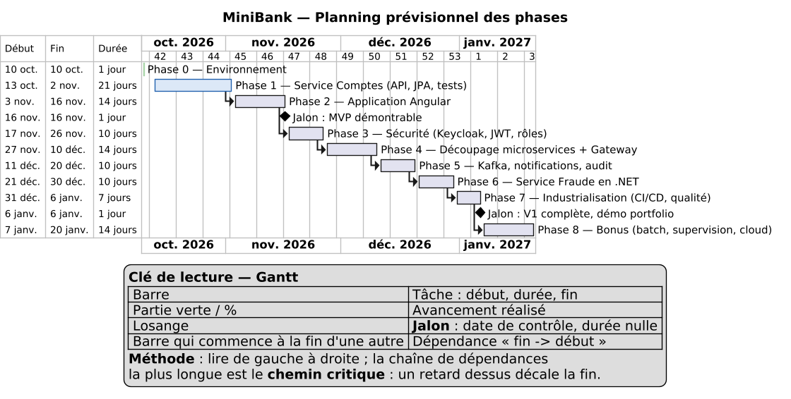{width=100%}

| Phase | Contenu | Livrables | Jalon |
|---|---|---|---|
| P0 | Environnement | Dépôt Git, service démarré, base PostgreSQL | Fait |
| P1 | Service Comptes | API REST, entités, tests, collection d'appels | — |
| P2 (E2) | Espace client React | Écrans tableau de bord, virement, historique | **MVP démontrable** |
| P3 | Sécurité | Keycloak, rôles, tests d'accès | — |
| P4 | Microservices | Service Virements, passerelle, résilience | — |
| P5 | Événements | Kafka, notifications, audit | — |
| P6 (E6) | Fraude en Python | Service FastAPI, contrat d'API ; back-office Angular | — |
| P7 | Industrialisation | CI/CD, SonarCloud, OpenAPI, Testcontainers | **V1 complète** |
| P8 | Bonus | Batch intérêts, supervision, déploiement cloud | — |

## Organisation et responsabilités (RACI)

R = réalise, A = approuve, C = consulté, I = informé.

| Activité | Product Owner | Développeur | Tuteur / relecteur |
|---|---|---|---|
| Rédiger et prioriser le backlog | A | R | C |
| Concevoir (UML, architecture) | C | R / A | C |
| Développer et tester | I | R / A | I |
| Revue de code | — | R | C |
| Recette | A | R | I |
| Mise en production (démo) | A | R | I |

# Qualité et validation

## Stratégie de tests

| Niveau | Objet | Outils | Part visée |
|---|---|---|---|
| Unitaire | Règles métier des entités et des services, sans Spring | JUnit 5, AssertJ, Mockito | ~70 % des tests |
| Intégration | API + base réelle, sérialisation, transactions | Spring Boot Test, MockMvc, Testcontainers | ~25 % |
| Bout en bout | Parcours utilisateur complet dans le navigateur | Playwright ou Cypress (phase 2+) | ~5 % |
| Charge | Performance et concurrence | k6 ou Gatling (phase 8) | Ponctuel |
| Sécurité | Droits, injections, dépendances vulnérables | Tests 401/403, OWASP Dependency-Check, SonarCloud | Continu |

Le plan de recette détaillé (cas de test reliés aux exigences) est dans `09_Tests_et_qualite` et dans l'onglet « Recette » du classeur de pilotage.

## Critères d'acceptation globaux (réception)

La V1 est réceptionnée quand :

1. toutes les exigences *Must* sont implémentées et leurs cas de test sont passants ;
2. aucune anomalie bloquante ou majeure n'est ouverte ;
3. les exigences ENF-02, ENF-04, ENF-05 et ENF-09 sont vérifiées ;
4. la documentation (README, OpenAPI, guide d'installation) permet à un tiers de lancer le projet en moins de 30 minutes ;
5. le Product Owner signe le procès-verbal de recette (modèle dans `10_Gestion_de_projet/modeles`).

## Definition of Done

Une user story est « terminée » seulement si :

- le code respecte les conventions du guide de développement et compile sans avertissement ;
- les tests unitaires et d'intégration couvrent les critères d'acceptation, et ils passent dans la CI ;
- la revue de code (grille) est faite, la *pull request* est fusionnée ;
- la documentation impactée est à jour (OpenAPI, README, diagrammes) ;
- la démonstration au Product Owner est faite ou planifiée.

# Risques

| ID | Risque | Probabilité | Impact | Mesure de prévention |
|---|---|---|---|---|
| R1 | Sous-estimation du temps (projet en parallèle des cours) | Forte | Moyen | Phases courtes, MVP d'abord, priorisation MoSCoW |
| R2 | Complexité des microservices trop tôt | Moyenne | Fort | Monolithe modulaire d'abord (ADR-002), découpage en P4 |
| R3 | Incohérence des soldes (concurrence) | Moyenne | Très fort | Transactions, verrouillage optimiste, tests de concurrence |
| R4 | Faille de sécurité (accès aux comptes d'autrui) | Moyenne | Très fort | Contrôle de propriété systématique, tests 403, revue OWASP |
| R5 | Conflits d'environnement local (ports, versions) | Forte | Faible | Docker Compose, ports documentés, guide d'installation |
| R6 | Dépendance obsolète ou vulnérable | Moyenne | Moyen | Versions stables uniquement, analyse des dépendances en CI |
| R7 | Perte de motivation ou d'élan | Moyenne | Fort | Démonstration visible à chaque phase, publication sur GitHub |

# Annexes

## Annexe A — Cycle de vie d'un virement

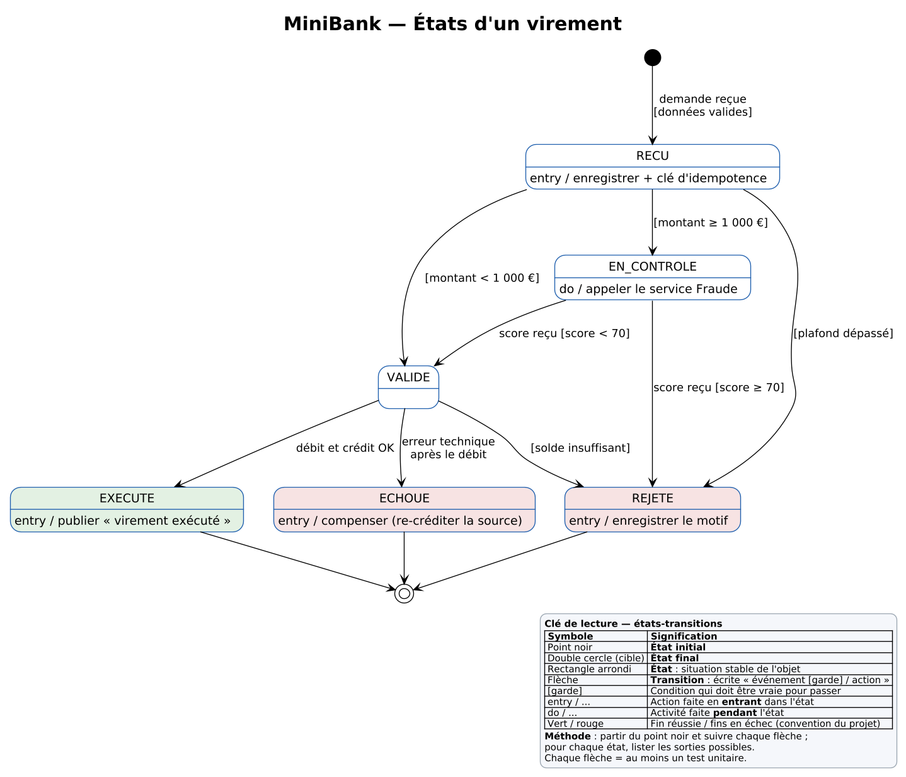{width=95%}

## Annexe B — Cycle de vie d'un compte

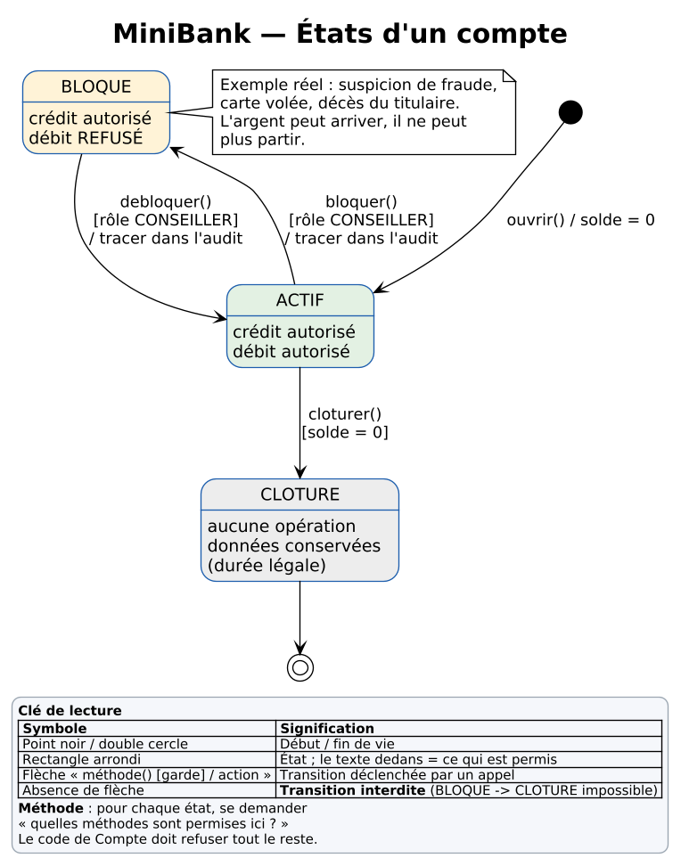{width=85%}

## Annexe C — Conception détaillée de la phase 1

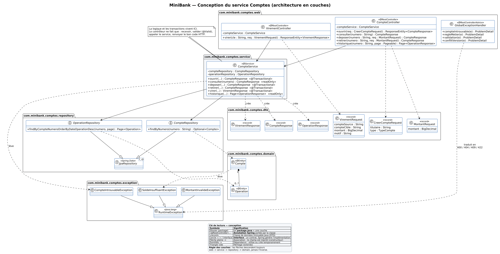{width=100%}

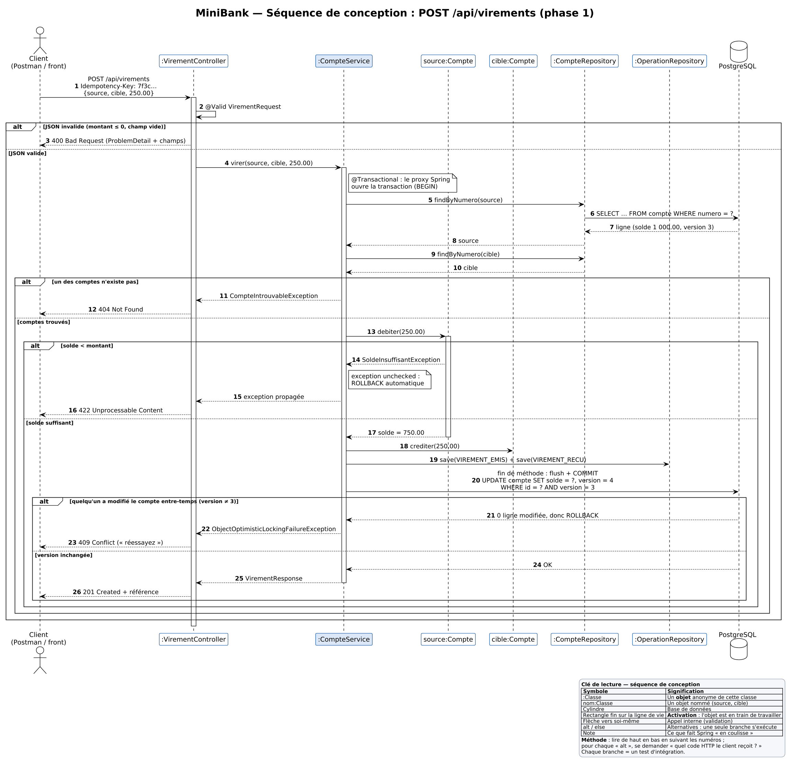{width=100%}

## Annexe D — Sécurité et architecture distribuée

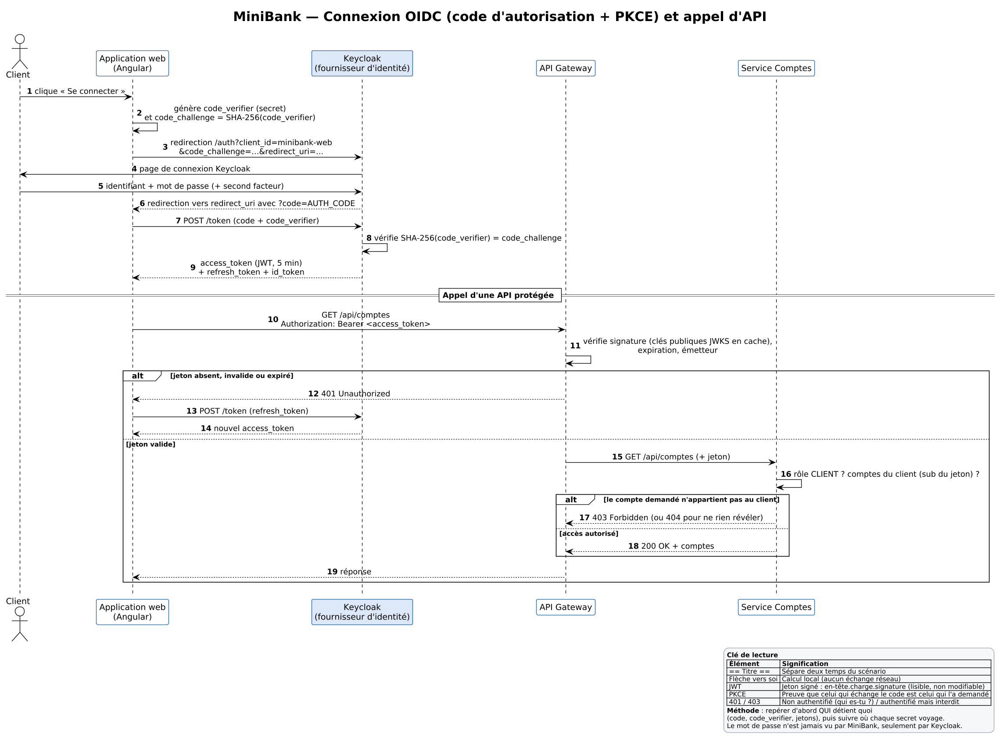{width=100%}

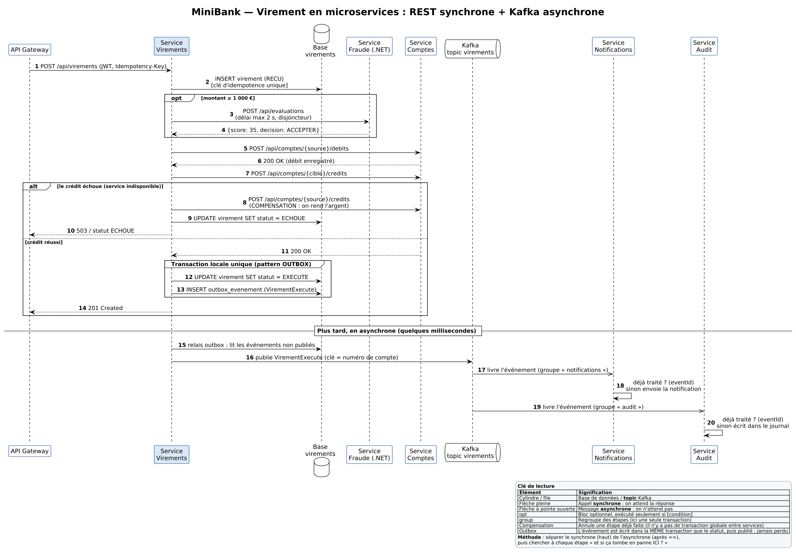{width=100%}

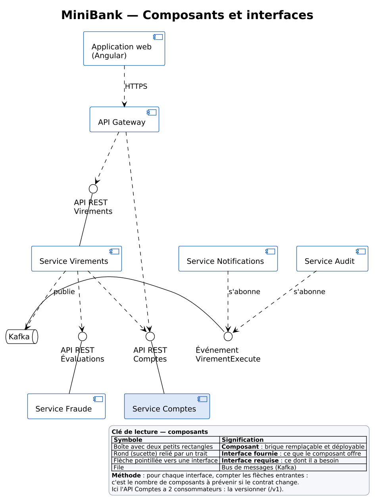{width=85%}

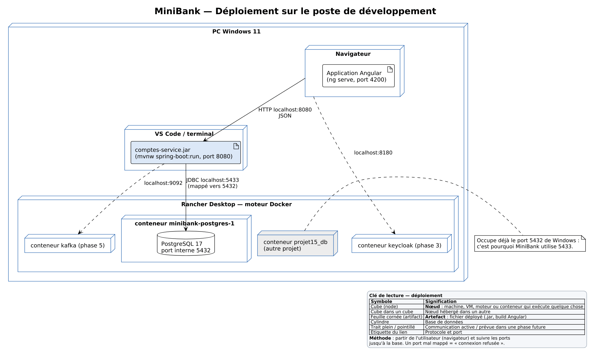{width=100%}

## Annexe E — Documents de référence

| Document | Emplacement dans le kit |
|---|---|
| Analyse des besoins, personas, user stories | `02_Analyse_des_besoins` |
| Guide de lecture des diagrammes UML | `03_UML/Guide_lecture_UML.md` |
| Dossier d'architecture et ADR | `04_Architecture` |
| Script SQL et données de test | `05_Base_de_donnees` |
| Contrat d'API OpenAPI | `06_API/openapi.yaml` |
| Guide de développement | `07_Guide_developpement` |
| Guide sécurité | `08_Securite` |
| Stratégie de tests et plan de recette | `09_Tests_et_qualite` |
| Backlog, traçabilité, recette, risques | `13_Outils/MiniBank_Pilotage.xlsx` |
