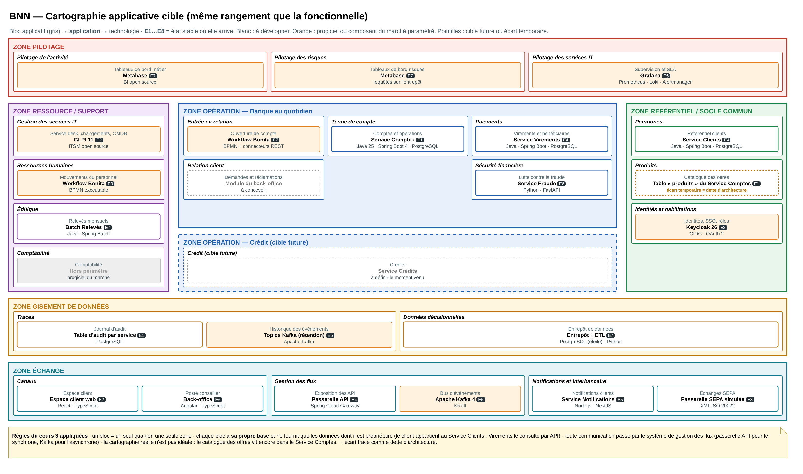
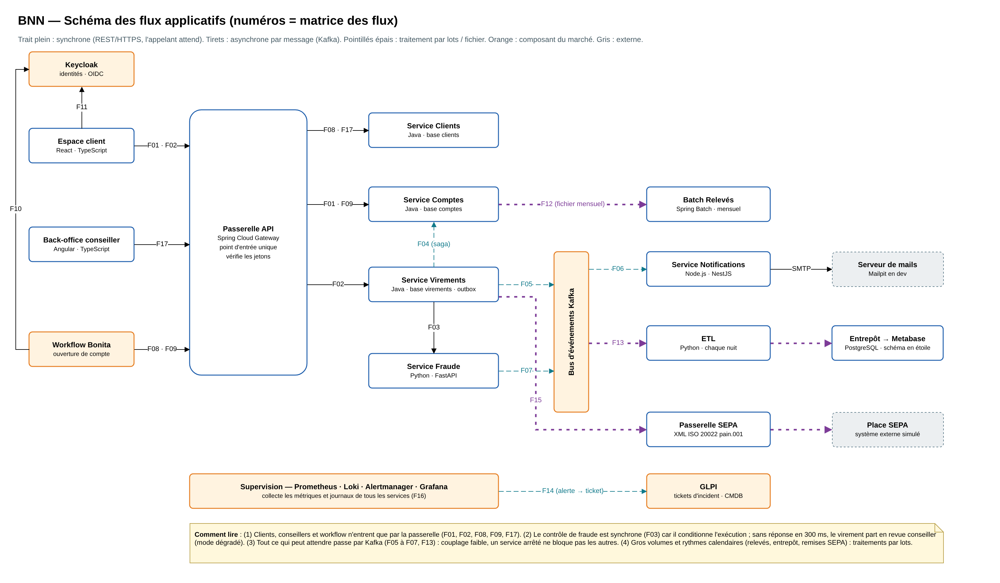

::: casquette
**Architecte applicatif** pour le découpage et les règles ; **architecte d'intégration** pour les flux. Le cours 3 te donne les règles, le cours 4 la démarche d'échanges en 4 étapes.
:::

# De la fonction à l'application

L'architecture applicative est « une instanciation de l'architecture fonctionnelle dans un environnement technique donné » (cours 3). Autrement dit : on garde **le même rangement** que la carte fonctionnelle, et on dit **quel logiciel** réalise chaque bloc.

::::: paysage

::: cle
- Dans chaque boîte : en petit gris le **bloc applicatif**, en gras **l'application**, dessous la **technologie**, et le badge **E1…E8** = l'état stable où elle arrive.
- **Blanc** = tu la développes. **Orange** = composant du marché que tu installes et paramètres (Keycloak, Kafka, GLPI, Bonita, Metabase, Grafana).
- **Pointillés** = cible future (Crédits, Réclamations) ou **écart temporaire** : le catalogue des offres vit dans le Service Comptes en attendant mieux.
- Le rangement en zones est identique à la carte fonctionnelle : tu peux poser les deux cartes côte à côte et vérifier qu'aucune fonction n'est orpheline.
:::
:::::

| Bloc fonctionnel | Application | Technologie | Type | Arrive en |
|---|---|---|---|---|
| Comptes, Opérations | Service Comptes | Java 25, Spring Boot 4, PostgreSQL | À développer | E1 (en cours) |
| Accès client en ligne | Espace client web | React, TypeScript | À développer | E2 |
| Support utilisateurs, changements | GLPI 11 | ITSM open source | Marché | E2 |
| Identités et droits | Keycloak 26 | OIDC, OAuth 2 | Marché | E3 |
| Mouvements du personnel | Workflow Bonita | BPMN exécutable | Marché | E3 |
| Clients | Service Clients | Java, Spring Boot | À développer | E4 |
| Virements, Bénéficiaires | Service Virements | Java, Spring Boot | À développer | E4 |
| Routage (exposer les services) | Passerelle API | Spring Cloud Gateway | À développer (configuration) | E4 |
| Routage (événements) | Bus d'événements | Apache Kafka 4 | Marché | E5 |
| Notifier le client | Service Notifications | Node.js, NestJS | À développer | E5 |
| Niveaux de service | Supervision | Prometheus, Loki, Grafana | Marché | E5 |
| Lutte contre la fraude | Service Fraude | Python, FastAPI | À développer | E6 |
| Poste conseiller | Back-office | Angular, TypeScript | À développer | E6 |
| Ouverture de compte | Workflow Bonita | BPMN + connecteurs REST | Marché | E7 |
| Relevés | Batch Relevés | Java, Spring Batch | À développer | E7 |
| Entrepôt de données | Entrepôt + ETL | PostgreSQL, Python | À développer | E7 |
| Indicateurs | Tableaux de bord | Metabase | Marché | E7 |
| Place SEPA | Passerelle SEPA simulée | Java, XML ISO 20022 | À développer | E8 |

# Les 4 règles des blocs, appliquées

Ces règles sont « très probables à l'examen » d'après ta fiche de révision. Dans MiniBank, elles deviennent des règles de code.

| Règle du cours 3 | Ce que cela donne dans MiniBank | Ce qui est interdit |
|---|---|---|
| 1. Un bloc appartient à un seul quartier et une seule zone | Le Service Virements est dans Opération › Paiements, point | Un service « fourre-tout » qui gère clients, comptes et virements |
| 2. Un bloc communique par messages et appels de services | API REST (contrat OpenAPI) ou événements Kafka | Partager des classes Java entre services, lire un fichier d'un autre service |
| 3. Un bloc a ses propres traitements et données | **Une base PostgreSQL par service** (ADR-012) | Une base unique partagée par tous les services |
| 4. Il peut consulter les données d'un autre, mais ne fournit que les siennes | Virements demande « ce compte existe-t-il ? » à l'API Comptes | Virements qui fait `UPDATE compte SET solde = …` dans la base de Comptes |

::: debutant
Pourquoi tant d'insistance sur « une base par service » ? Parce que si deux services partagent une table, aucun des deux ne peut plus la modifier sans casser l'autre. Tu retrouves le **découplage** du cours : changer la batterie sans toucher au téléphone. La contrepartie est réelle : un virement entre deux bases ne tient plus dans une seule transaction SQL, d'où la *saga* de l'état E4 (voir plus bas).
:::

# La démarche d'échanges en 4 étapes (cours 4)

## Étape 1 — Décrire chaque bloc

Fait ci-dessus, avec ses contraintes de sécurité et de disponibilité (niveaux de service dans le document 05).

::::: paysage
## Étape 2 — La cartographie des flux

::: cle
- **Trait plein** : appel **synchrone** (l'appelant attend la réponse, comme un appel téléphonique).
- **Tirets** : message **asynchrone** via Kafka (on dépose et on continue, comme un SMS).
- **Pointillés épais** : **traitement par lots** ou fichier (relevés mensuels, entrepôt de nuit, remises SEPA).
- Chaque flèche porte un numéro **F01 à F17**, qui renvoie à la matrice ci-dessous.
- La **passerelle** est l'unique porte d'entrée pour les clients, les conseillers et le workflow ; **Kafka** est le carrefour de tout ce qui peut attendre.
:::
:::::

## Étape 3 — La matrice des flux

C'est le premier livrable de la démarche d'échanges. La version complète (avec sens, contenu et justification) est dans `Referentiel_SI_BNN.xlsx`, onglet **Matrice des flux**.

::::: paysage
| N° | Flux | Source → cible | Mode | Fréquence · volume | Techno · format | En |
|---|---|---|---|---|---|---|
| F01 | Consulter comptes et historique | Espace client → passerelle → Comptes | Synchrone | Élevée · 2 à 10 Ko | REST HTTPS · JSON | E2 |
| F02 | Initier un virement | Espace client → passerelle → Virements | Synchrone | Moyenne · 1 Ko | REST + clé d'idempotence · JSON | E2 |
| F03 | Évaluer le risque | Virements → Fraude | Synchrone, délai max 300 ms | Moyenne · 1 Ko | REST · JSON | E6 |
| F04 | Débiter, créditer (saga) | Virements ⇄ Comptes | Asynchrone (synchrone en E4) | Moyenne · 1 Ko | Kafka (REST en E4) · JSON | E4-E5 |
| F05 | Publier « virement exécuté » | Virements → Kafka | Asynchrone | Au fil de l'eau · 1 Ko | Kafka + outbox · JSON versionné | E5 |
| F06 | Notifier le client | Kafka → Notifications → mail | Asynchrone | Au fil de l'eau · 1 Ko | Kafka, SMTP · JSON → e-mail | E5 |
| F07 | Publier une alerte de fraude | Fraude → Kafka | Asynchrone | Faible · 1 Ko | Kafka · JSON | E6 |
| F08 | Créer le client | Bonita → passerelle → Clients | Synchrone | Faible (~50 par jour) · 2 Ko | REST · JSON | E7 |
| F09 | Ouvrir le compte | Bonita → passerelle → Comptes | Synchrone | Faible · 1 Ko | REST · JSON | E7 |
| F10 | Créer l'identité de connexion | Bonita → Keycloak | Synchrone | Faible · 1 Ko | API d'administration Keycloak | E7 |
| F11 | S'authentifier | Navigateurs → Keycloak | Synchrone | Élevée · 2 Ko | OIDC (code + PKCE) · jeton JWT | E3 |
| F12 | Exporter les opérations du mois | Comptes → Batch Relevés | Par lots | Mensuelle · quelques Mo | Fichier CSV | E7 |
| F13 | Alimenter l'entrepôt | Kafka → ETL → entrepôt | Par lots | Chaque nuit · Mo à Go | ETL Python · tables en étoile | E7 |
| F14 | Ouvrir un ticket d'incident | Alertmanager → GLPI | Asynchrone | À l'alerte · 1 Ko | Webhook REST · JSON | E5 |
| F15 | Émettre les virements externes | Virements → passerelle SEPA | Par lots | Plusieurs remises par jour · Ko à Mo | Fichier XML ISO 20022 pain.001 | E8 |
| F16 | Collecter métriques et journaux | Tous les services → supervision | Asynchrone | Toutes les 15 s · Ko | Prometheus, Loki | E5 |
| F17 | Consulter clients et alertes | Back-office → passerelle → Clients, Fraude | Synchrone | Moyenne · 2 à 10 Ko | REST · JSON | E6 |
:::::

## Étape 4 — Une cinématique représentative

La matrice donne une vision **statique**. La cinématique donne la vision **dynamique** : l'ordre des échanges pour un cas d'utilisation. Voici celle du virement de Claire (1 500 €), à l'état cible.

::: scenario
1. Claire clique sur *Valider* dans l'Espace client, qui envoie **F02** à la passerelle avec son jeton (obtenu par **F11**) et une clé d'idempotence.
2. La passerelle vérifie le jeton, puis transmet au Service Virements.
3. Virements vérifie solde, plafonds et statut du compte (RG-03 à RG-06). Montant ≥ 1 000 € : il appelle Fraude (**F03**), qui répond « score 50 » en 40 ms.
4. Score < 70 : Virements enregistre le virement et, **dans la même transaction**, une ligne dans sa table *outbox*.
5. Un relais lit l'outbox et publie la commande de débit-crédit (**F04**) et l'événement « virement exécuté » (**F05**) dans Kafka.
6. Comptes débite et crédite, puis confirme. Notifications reçoit **F05** et envoie l'e-mail (**F06**).
7. Cette nuit, l'ETL lit les événements du jour (**F13**) et l'entrepôt compte un virement de plus.
:::

Si Notifications est arrêté à l'étape 6, **le virement réussit quand même** : l'événement attend dans Kafka et l'e-mail part au redémarrage. C'est exactement ce que ton cours appelle le couplage faible.

# Comment choisir : synchrone, asynchrone ou lots ?

L'arbre de décision de ta fiche de révision, appliqué à MiniBank :

| Question | Si oui | Exemple MiniBank |
|---|---|---|
| Quelqu'un attend-il la réponse pour continuer ? | **Synchrone** (API REST) | F03 : sans score, on ne sait pas s'il faut exécuter |
| Peut-on traiter plus tard, message par message ? | **Asynchrone** (Kafka) | F06 : l'e-mail peut partir 10 secondes plus tard |
| Plusieurs systèmes s'intéressent-ils au même événement ? | **Publication-abonnement** (un topic Kafka, plusieurs consommateurs) | F05 : lu par Notifications, l'ETL et l'audit |
| Gros volume, fenêtre de temps (la nuit, le mois) ? | **Lots** : batch ou ETL | F12, F13 |
| Système externe, standard imposé ? | **Format standard** (interopérabilité) | F15 : XML ISO 20022 pour SEPA |

::: attention
**Pas d'ESB au cœur des microservices** (cours 3) : un ESB contient de la logique de routage et de transformation, ce qui recrée du couplage. Kafka est un *message broker* « bête » : il transporte, il ne décide pas. La logique reste dans les services.
:::

# Monolithe d'abord, microservices ensuite

Ton cours compare monolithe, composite et microservices. MiniBank suit volontairement les trois âges :

| État | Architecture | Pourquoi |
|---|---|---|
| E1-E3 | **Monolithe modulaire** : un seul Service Comptes, mais découpé en packages qui respectent déjà les blocs | On apprend le métier sans payer la complexité du distribué (ADR-002) |
| E4 | **Découpage** : Clients et Virements sortent en services, avec leur base | Les frontières sont connues et stables ; le découpage devient mécanique |
| E5 et après | **Microservices + événements** : Kafka, outbox, saga | On ajoute le couplage faible là où il apporte quelque chose |

::: retenir
En entretien : « J'ai commencé par un monolithe modulaire parce que découper avant de connaître les frontières métier coûte cher. Les packages suivaient déjà les blocs de ma cartographie, donc le découpage en E4 a été un déplacement de code, pas une réécriture. »
:::

# À faire et à éviter

::: faire
- Numéroter chaque flux et le tenir à jour dans la matrice **avant** de le coder.
- Mettre un numéro de version dans chaque interface (`/api/v1/…`, événements `virements.v1.executes`) : c'est le **principe d'indépendance** du cours.
- Prévoir le **mode dégradé** de chaque appel synchrone (délai, repli).
:::

::: eviter
- Lire ou écrire dans la base d'un autre service.
- Un appel synchrone là où l'appelant n'a pas besoin de la réponse.
- Envoyer 2 millions de relevés par appels REST unitaires : c'est un batch.
:::
