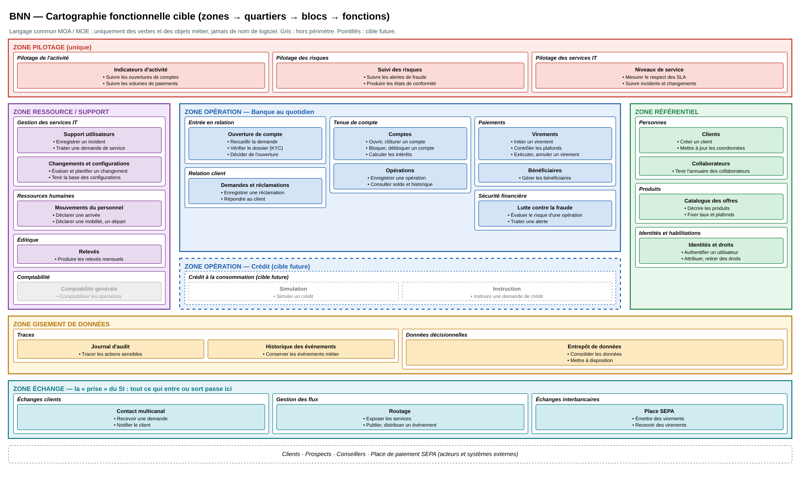

::: casquette
**Architecte métier**, qui joue ici le rôle d'**urbaniste** : il est responsable de l'architecture fonctionnelle (cours 1). La cartographie se valide avec la MOA (le métier) et la DSI.
:::

# À quoi sert cette carte

La cartographie fonctionnelle liste **tout ce que le SI sait faire**, dans un langage que le métier et l'informatique comprennent tous les deux. Elle fait le pont entre les processus (ce que font les gens) et les applications (les logiciels).

Elle rend quatre services, cités dans ton cours 2 :

1. **Rationaliser le parc applicatif** : si deux applications font la même fonction, la carte le montre.
2. **Donner une vision globale** du SI en une page.
3. **Faciliter les études d'impact** : « si je change la fonction X, qui est touché ? ».
4. **Relier processus et applications** : chaque tâche informatisée pointe vers une fonction, chaque fonction vers une application.

::::: paysage
# La carte de la BNN

::: cle
- **Un grand cadre de couleur = une zone.** Il y en a 6, comme dans toute architecture fonctionnelle (plus une zone Crédit future, en pointillés).
- **Un cadre blanc au titre en italique = un quartier** : un domaine métier dans la zone.
- **Une boîte colorée = un bloc fonctionnel**, avec en gras son nom et en dessous ses **fonctions SI** (puces).
- **Gris** = hors périmètre (la comptabilité existe mais tu ne la construis pas). **Pointillés** = cible future.
- Le bandeau du bas rappelle qui est **à l'extérieur** du SI : clients, prospects, conseillers, place SEPA. Tout ce qui entre ou sort passe par la zone Échange.
:::
:::::

# Les 6 zones expliquées avec MiniBank

| Zone | Son rôle (cours 2) | Quartiers BNN | Piège à éviter |
|---|---|---|---|
| **Pilotage** (unique) | Tableaux de bord, indicateurs | Activité, risques, services IT | En créer deux : la zone Pilotage est unique |
| **Opération** (une par métier) | Le cœur du métier, la valeur client | Entrée en relation, tenue de compte, paiements, sécurité financière, relation client | Y mettre la gestion des clients (elle sert à tous : Référentiel) |
| **Ressource / support** | Ce qui n'est pas le métier | Services IT, RH, éditique, comptabilité | Y mettre la fraude : c'est du métier bancaire |
| **Référentiel** | Données communes et stables | Personnes, produits, identités et habilitations | Confondre avec le gisement |
| **Gisement de données** | Données dynamiques et leurs services d'accès | Traces (audit, événements), données décisionnelles | Y ranger les clients (stables : Référentiel) |
| **Échange** | La « prise » du SI | Échanges clients, gestion des flux, interbancaire | Oublier que les canaux (web, e-mail) passent par là |

::: debutant
**Référentiel ou gisement ?** Le référentiel contient ce qui change *rarement* et que *tout le monde* lit : la fiche d'un client, le catalogue des produits. Le gisement contient ce qui *s'accumule* en continu : l'historique des événements, le journal d'audit, l'entrepôt de données. Image simple : le référentiel est l'annuaire, le gisement est le journal de bord.
:::

# Comment cette carte a été construite

La méthode, à refaire toi-même sur une feuille avant de regarder la carte :

1. **Poser les 6 zones** : elles existent dans toute entreprise.
2. **Lister les fonctions** à partir des processus (niveaux 3 et 4) : verbe + objet. Exemple : « Initier un virement ».
3. **Regrouper en blocs les fonctions qui manipulent le même objet métier** : toutes les fonctions sur l'objet *Virement* forment le bloc Virements.
4. **Regrouper les blocs en quartiers** par domaine métier : Virements + Bénéficiaires = quartier Paiements.
5. **Placer les données partagées en Référentiel**, ce qui entre ou sort en Échange, les indicateurs en Pilotage.

Les choix qui méritent une justification (on te les demandera) :

| Choix | Justification |
|---|---|
| « Créer un client » en Référentiel, pas dans Entrée en relation | Le client est lu par tous les blocs ; l'entrée en relation le *demande*, le référentiel le *possède* |
| « Lutte contre la fraude » en Opération, pas en Pilotage | Elle agit sur chaque opération, en temps réel ; le *suivi* des alertes, lui, est en Pilotage |
| « Authentifier un utilisateur » en Référentiel › Identités | C'est un service commun à tous les métiers (le « socle commun » de ton exercice de découpage) |
| « Produire les relevés » en Support › Éditique | Produire des documents n'est pas le métier ; c'est une ressource au service du métier |
| « Mesurer le respect des SLA » en Pilotage | C'est un indicateur qui contrôle un autre processus |

# Scénario : où ranger une nouvelle fonction ?

::: scenario
La MOA t'envoie trois nouvelles demandes. Avant de coder quoi que ce soit, tu dois dire **où** elles vont. Cache la colonne de droite.
:::

| Nouvelle fonction | Où la ranger | Raisonnement |
|---|---|---|
| Plafonner les virements à 10 000 € par jour | Opération › Paiements › Virements | Elle porte sur l'objet *Virement* |
| Envoyer un code par SMS avant un virement | Échange › Échanges clients › Contact multicanal | C'est une sortie vers le client ; la *décision* d'en envoyer un reste dans Virements |
| Calculer le taux de faux positifs de la fraude | Pilotage › Pilotage des risques | C'est un indicateur sur un autre processus |
| Archiver les relevés 10 ans | Gisement › Traces | Accumulation de documents dans le temps |

Ensuite seulement, la casquette d'architecte applicatif dira **quelle application** réalise chaque fonction (document 04).

# Exercice : le tableau du cours, rempli pour MiniBank

Le fichier Excel `Referentiel_SI_BNN.xlsx` (onglet **Fonctions SI**) reprend exactement le format de l'exercice « liste des fonctions » de ton cours 2 : *fonctionnalité · macro-donnée · bloc fonctionnel · zone*. Il est rempli pour MiniBank ; ajoute-y chaque nouvelle fonction **avant** de la développer.

# À faire et à éviter

::: faire
- Un bloc = un objet métier principal ; une fonction = un verbe + un objet.
- Tenir la carte à jour : un **référentiel** (le fichier Excel), un **outil** (draw.io), un **garant** (toi, casquette urbaniste). Ce sont les trois conditions du cours.
- Dessiner l'existant **et** la cible : la différence entre les deux, c'est ta trajectoire.
:::

::: eviter
- Un nom de logiciel (« PostgreSQL », « Keycloak ») sur cette carte.
- Ranger une fonction selon *l'équipe* qui la code au lieu de *l'objet métier* qu'elle manipule.
- Créer un bloc « Divers » : si une fonction ne trouve pas sa place, c'est qu'il manque un objet métier.
:::
